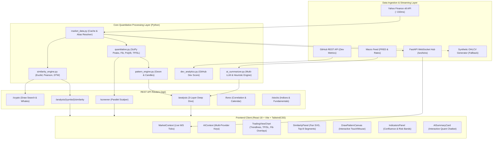

# ATRED: Arsitektur Sistem & Spesifikasi Engine Analisis Kuantitatif
> **Dokumen Teknis Komprehensif untuk Tim Pengembang (Core Engineering & Quantitative Developer)**  
> **Versi Dokumen:** 2.0.0 | **Klasifikasi:** Arsitektur Teknis, Model Kuantitatif, & Panduan Pengembangan Lanjutan  
> **Platform:** ATRED (Multi-Asset Quantitative Trading Analysis Platform)  
> **Aset Terpadu:** Kripto (Crypto), Forex (+ Gold / XAUUSD), Saham & Indeks Global (Stocks & Indices)

---

## Daftar Isi
1. [Ringkasan Eksekutif & Filosofi Sistem](#1-ringkasan-eksekutif--filosofi-sistem)
2. [Topologi Arsitektur Sistem & Direktori](#2-topologi-arsitektur-sistem--direktori)
3. [Deep Dive: Engine Analisis Kuantitatif](#3-deep-dive-engine-analisis-kuantitatif)
   - [3.1. Layer 1: Geometric & Technical Indicator Engine](#31-layer-1-geometric--technical-indicator-engine)
   - [3.2. Historical Similarity Engine (Pure Algorithmic Quant Pattern Matcher)](#32-historical-similarity-engine-pure-algorithmic-quant-pattern-matcher)
   - [3.3. Interactive Canvas Draw-to-Search Pattern Engine](#33-interactive-canvas-draw-to-search-pattern-engine)
   - [3.4. Layer 2: Developer & On-Chain Analytics Engine](#34-layer-2-developer--on-chain-analytics-engine)
   - [3.5. Layer 3: Macro & Multi-Provider AI Synthesis Engine](#35-layer-3-macro--multi-provider-ai-synthesis-engine)
   - [3.6. Cross-Market Scalping Screener Engine](#36-cross-market-scalping-screener-engine)
4. [Arsitektur Data Feed, Caching, & WebSocket Streaming](#4-arsitektur-data-feed-caching--websocket-streaming)
5. [Spesifikasi API Endpoint & Kontrak Data](#5-spesifikasi-api-endpoint--kontrak-data)
6. [Arsitektur Frontend & Visualisasi Interaktif](#6-arsitektur-frontend--visualisasi-interaktif)
7. [Roadmap & Panduan Pengembangan Lanjutan untuk Tim Developer](#7-roadmap--panduan-pengembangan-lanjutan-untuk-tim-developer)

---

## 1. Ringkasan Eksekutif & Filosofi Sistem

**ATRED** adalah platform analitik perdagangan multi-aset generasi baru yang memadukan **perhitungan kuantitatif deterministik murni (Python/NumPy/SciPy/Pandas)** dengan **kecerdasan buatan multi-model (Google Gemini, OpenAI, DeepSeek, Groq, Ollama)** dan **visualisasi real-time tingkat tinggi (TradingView Lightweight Charts & Canvas)**.

### Prinsip Utama Sistem:
1. **Analisis Deterministik Tanpa Halusinasi (Math-First Approach):**
   Semua sinyal perdagangan utama, pivot, support/resistance, Fibonacci, rasio reward-to-risk, dan pencocokan pola historis dihitung murni menggunakan matematika diskrit dan aljabar linier. AI **tidak pernah** digunakan untuk menghitung angka harga mentah, melainkan untuk melakukan *sintesis naratif eksekutif*, membaca konteks makro, dan merumuskan skenario taktis.
2. **Eliminasi Kontradiksi Sinyal (Unified Directional Alignment):**
   Sistem menerapkan algoritma evaluasi multi-faktor komprehensif (`determine_comprehensive_signal`) yang menyatukan pola geometri, struktur Moving Average, momentum RSI/MACD, Stochastic slow, dan struktur Fibonacci menjadi satu skor konsensus (-100 hingga +100), memastikan Entry, TP, SL, dan rekomendasi arah perdagangan selalu selaras.
3. **Pencarian Kemiripan Historis Tanpa AI (Historical Similarity Engine):**
   Mekanisme pemindaian pola berbasis vektorisasi array yang menguji 3 metode metrik (Euclidean z-score, Pearson correlation, dan Dynamic Time Warping dengan Sakoe-Chiba band) untuk memproyeksikan probabilitas pergerakan masa depan (*forward projection distribution*) berdasarkan preseden historis nyata.
4. **Resiliensi Data Tingkat Tinggi (Zero-Downtime Feed):**
   Integrasi langsung Yahoo Finance API v8 (~150ms) dengan memori caching berlapis dan *synthetic random walk drift fallback* yang menjamin sistem tetap dapat menyajikan data dan berfungsi penuh meskipun API eksternal mengalami latensi atau rate-limiting.

---

## 2. Topologi Arsitektur Sistem & Direktori

### Diagram Alur Data Sistem



### Struktur Direktori Repositori

```
d:/Atred/
├── backend/
│   ├── app/
│   │   ├── api/
│   │   │   ├── routers/
│   │   │   │   ├── analysis.py        # Endpoints 3-Layer Deep Analysis & AI Query
│   │   │   │   ├── crypto.py          # Endpoints Kripto, Draw-to-Search, On-Chain Whales
│   │   │   │   ├── forex.py           # Endpoints Forex, Currency Correlation Matrix, Economic Calendar
│   │   │   │   ├── screener.py        # Scalping Screener multithreaded & scoring 0-100
│   │   │   │   ├── similarity.py      # Endpoint Historical Similarity Engine (multi-probe)
│   │   │   │   ├── stocks.py          # Endpoints Saham, Indeks Global (^JKSE, ^GSPC), Fundamental
│   │   │   │   └── ws.py              # WebSocket hub streaming real-time ticks
│   │   │   └── api_router.py          # Aggregator router FastAPI
│   │   ├── core/
│   │   │   ├── config.py              # Konfigurasi Pydantic Settings & environment variables
│   │   │   └── quantitative.py        # Kumpulan fungsi kuantitatif deterministik (NumPy/SciPy)
│   │   ├── services/
│   │   │   ├── ai_summarizer.py       # Multi-LLM provider adapter & Heuristic fallback synthesizer
│   │   │   ├── dev_analytics.py       # Algoritma ekstraksi metrik GitHub & kalkulasi Dev Score
│   │   │   ├── market_data.py         # HTTPX Yahoo client, symbol aliasing, in-memory cache, synthetic
│   │   │   ├── pattern_engine.py      # Pengklasifikasi pola geometri grafik & formasi candlestick
│   │   │   └── similarity_engine.py   # Engine kesamaan pola historis (Euclidean, Pearson, DTW)
│   │   └── main.py                    # Bootstrap FastAPI application & CORS setup
│   ├── requirements.txt               # Dependensi backend Python
│   ├── run_backend.py                 # Script runner backend dengan Uvicorn
│   ├── test_core.py                   # Unit test algoritma kuantitatif
│   ├── test_api.py                    # Integration test REST API
│   └── test_similarity.py             # Test suite performa & validitas similarity engine
│
├── frontend/
│   ├── src/
│   │   ├── components/
│   │   │   ├── analysis/
│   │   │   │   ├── AISummaryCard.jsx      # Panel narasi 3-layer, kalkulator risiko, interactive chat
│   │   │   │   ├── DevActivityChart.jsx   # Grafik aktivitas GitHub & skor on-chain
│   │   │   │   ├── IndicatorsPanel.jsx    # Matriks indikator teknikal, Fibonacci, & Confluence
│   │   │   │   └── SimilarityPanel.jsx    # Panel Historical Similarity, fan SVG chart, overlay segmen
│   │   │   ├── charts/
│   │   │   │   ├── DrawPatternCanvas.jsx  # Kanvas interaktif penggambaran pola mouse/touch
│   │   │   │   ├── PatternMatchLargeChart.jsx # Grafik perbandingan pola yang digambar vs pola live
│   │   │   │   ├── PatternSearchResults.jsx   # Grid kartu hasil pencarian koin kripto live
│   │   │   │   ├── TradingViewChart.jsx       # Lightweight Charts + overlay trendline, Fib, TP/SL
│   │   │   │   └── TradingViewEmbedWidget.jsx # Official TradingView advanced chart embed
│   │   │   ├── common/
│   │   │   │   ├── DisclaimerFooter.jsx   # Banner NFA (Not Financial Advice)
│   │   │   │   └── Navbar.jsx             # Navigasi utama, ticker status WebSocket, AI Settings modal
│   │   │   ├── macro/
│   │   │   │   ├── CurrencyCorrelation.jsx# Heatmap matriks korelasi mata uang forex
│   │   │   │   └── EconomicCalendar.jsx   # Kalender rilis berita ekonomi berdampak tinggi
│   │   │   └── screener/
│   │   │       └── ScreenerTable.jsx      # Tabel screener scalping multi-timeframe & sorting
│   │   ├── context/
│   │   │   ├── AIContext.jsx              # State manajemen konfigurasi provider & model AI
│   │   │   └── MarketContext.jsx          # WebSocket client state, live ticker, connection status
│   │   ├── pages/
│   │   │   ├── AssetDetail.jsx            # Tampilan utama 3-Layer Deep Analysis per aset
│   │   │   ├── CryptoDashboard.jsx        # Dashboard Kripto terintegrasi Draw Pattern Search
│   │   │   ├── ForexDashboard.jsx         # Dashboard Forex dengan Heatmap & Kalender
│   │   │   ├── HomeDashboard.jsx          # Screener terpadu cross-market opportunity
│   │   │   └── StockDashboard.jsx         # Dashboard Saham & Indeks Global
│   │   ├── services/
│   │   │   └── api.js                     # Axios HTTP client untuk seluruh backend REST endpoints
│   │   ├── utils/
│   │   │   └── formatters.js              # Formatting currency, persentase, tanggal, pips
│   │   ├── App.jsx                        # React Router routing setup
│   │   └── main.jsx                       # Entry point React Vite
│   ├── package.json
│   └── vite.config.js
│
├── start_platform.bat                 # Script startup 1-klik Windows (Backend + Frontend)
├── README.md                          # Dokumentasi pengenalan pengguna
├── plan.md                            # Spesifikasi arsitektur teknis acuan
├── revplan.md                         # Spesifikasi teknis Historical Similarity Engine
├── UI_UX_SPECIFICATION.md             # Panduan desain fintech & token styling
└── SYSTEM_ARCHITECTURE_AND_ANALYSIS.md# Dokumen teknis komprehensif ini
```

---

## 3. Deep Dive: Engine Analisis Kuantitatif

Bagian ini membedah secara mendalam seluruh logika matematika, algoritma, pembobotan, dan penanganan edge case yang menjadi fondasi sistem ATRED.

```
┌────────────────────────────────────────────────────────────────────────┐
│                   3-LAYER DEEP ANALYSIS ARCHITECTURE                   │
├────────────────────────────────────────────────────────────────────────┤
│ LAYER 1: QUANTITATIVE TECHNICAL & GEOMETRIC PATTERN ENGINE             │
│   ├── SciPy Peak Detection & NumPy Polyfit Trendline Bounding          │
│   ├── Geometric Chart Pattern Recognition (Triangles, Channels, W/M)   │
│   ├── Classical Indicators (Wilder's RSI, ATR, MACD, Bollinger Bands)  │
│   ├── Professional Impulse Fibonacci Retracement & Extension Anchoring │
│   ├── Multi-Factor Directional Alignment & Confluence Scoring (-100..+100)│
│   └── Dynamic Asymmetrical TP/SL & Risk-to-Reward Ratio Engine         │
├────────────────────────────────────────────────────────────────────────┤
│ HISTORICAL SIMILARITY ENGINE (PURE PYTHON / NO AI)                    │
│   ├── 3-Metric Distance (Euclidean z-score, Pearson, DTW Sakoe-Chiba)  │
│   ├── Feature Extraction 65% Price, 15% Volume, 20% Technical Stack   │
│   ├── Vectorized Sliding Window Matrix via Strided Memory Views        │
│   └── Forward Projection Fan Distribution (P25, Median, P75, Prob Up)  │
├────────────────────────────────────────────────────────────────────────┤
│ LAYER 2: DEVELOPER & ON-CHAIN ANALYTICS ENGINE                         │
│   ├── GitHub Velocity Metrics (Commits, Active Contributors, Merged PRs│
│   └── On-Chain Distribution (Whale Concentration, Staking Lock Ratio)  │
├────────────────────────────────────────────────────────────────────────┤
│ LAYER 3: MACRO & MULTI-PROVIDER AI SYNTHESIS ENGINE                    │
│   ├── Macro Context (Fed Rate, US CPI, DXY Index, Fear/Greed)          │
│   ├── Multi-LLM Adapters (Google Gemini, OpenAI, DeepSeek, Groq, Local)│
│   └── Heuristic Fallback Engine (Zero Hallucination Guaranteed)        │
└────────────────────────────────────────────────────────────────────────┘
```

---

### 3.1. Layer 1: Geometric & Technical Indicator Engine
*Implementasi: [quantitative.py](file:///d:/Atred/backend/app/core/quantitative.py) dan [pattern_engine.py](file:///d:/Atred/backend/app/services/pattern_engine.py)*

#### A. Deteksi Pivot & Regresi Trendline Bounded Non-Crossing
1. **Deteksi Pivot Swing:**
   Menggunakan `scipy.signal.find_peaks`:
   $$\text{Swing High} = \text{find\_peaks}(H, \text{distance}=d)$$
   $$\text{Swing Low} = \text{find\_peaks}(-L, \text{distance}=d)$$
   Di mana $d = \max(3, \lfloor N / 20 \rfloor)$.
2. **Regresi Linier Trendline Polyfit:**
   $$\text{Slope}_{\text{upper}}, \text{Intercept}_{\text{upper}} = \text{polyfit}(X_{\text{high}}, Y_{\text{high}}, 1)$$
   $$\text{Slope}_{\text{lower}}, \text{Intercept}_{\text{lower}} = \text{polyfit}(X_{\text{low}}, Y_{\text{low}}, 1)$$
3. **Bounded Non-Crossing Channel Enforcement:**
   Pada regresi murni, garis Upper dan Lower berisiko saling bersilangan (*cross inverted*). ATRED menerapkan aturan proteksi geometris:
   $$\text{Margin}_{\text{min}} = (\max(H) - \min(L)) \times 0.015$$
   Jika $U(t) < L(t) + \text{Margin}_{\text{min}}$, maka:
   $$U(t) = \text{Mid}(t) + \frac{\text{Margin}_{\text{min}}}{2}, \quad L(t) = \text{Mid}(t) - \frac{\text{Margin}_{\text{min}}}{2}$$
   Hal ini menjamin garis batas resistensi selalu berada di atas batas support secara matematis valid di atas chart.

#### B. Klasifikasi Pola Geometris Grafik
Kemiringan garis dinormalisasi terhadap harga rata-rata aset ($\bar{P}$):
$$s_u = \frac{\text{Slope}_{\text{upper}}}{\bar{P}}, \quad s_l = \frac{\text{Slope}_{\text{lower}}}{\bar{P}}$$

| Pola Geometri | Syarat Kemiringan ($s_u, s_l$) | Bias Sinyal | Confidence |
| :--- | :--- | :--- | :---: |
| **Symmetrical Triangle** | $s_u < -0.0005$ dan $s_l > 0.0005$ | Breakout / Konsolidasi | 82% |
| **Ascending Triangle** | $\|s_u\| < 0.0003$ dan $s_l > 0.0005$ | Bullish Breakout | 88% |
| **Descending Triangle** | $s_u < -0.0005$ dan $\|s_l\| < 0.0003$ | Bearish Breakdown | 85% |
| **Bull Flag / Upward Channel** | $\|s_u - s_l\| < 0.0004$ dan $s_u > 0.0005$ | Bullish | 78% |
| **Bear Flag / Downward Channel**| $\|s_u - s_l\| < 0.0004$ dan $s_u < -0.0005$ | Bearish | 76% |
| **Double Bottom (W-Pattern)** | $\frac{\|L_1 - L_2\|}{L_1} < 0.015$ (2 Lows berjarak $\le 1.5\%$) | Strong Bullish Reversal | 90% |
| **Double Top (M-Pattern)** | $\frac{\|H_1 - H_2\|}{H_1} < 0.015$ (2 Highs berjarak $\le 1.5\%$) | Strong Bearish Reversal | 90% |
| **Horizontal Channel** | $\|s_u - s_l\| < 0.0004$ dan $\|s_u\| \le 0.0005$ | Netral / Akumulasi | 70% |

#### C. Indikator Klasik & Wilder's Smoothing
- **RSI Wilder (RMA):**  
  Menggunakan skema penghalusan eksponensial standar TradingView:
  $$\alpha = \frac{1}{\text{period}}, \quad \text{AvgGain}_t = \alpha \cdot \text{Gain}_t + (1 - \alpha) \cdot \text{AvgGain}_{t-1}$$
  $$\text{RS} = \frac{\text{AvgGain}}{\text{AvgLoss}}, \quad \text{RSI} = 100 - \frac{100}{1 + \text{RS}}$$
- **ATR (Average True Range):**
  $$\text{TR}_t = \max(H_t - L_t, \, |H_t - C_{t-1}|, \, |L_t - C_{t-1}|)$$
  $$\text{ATR}_t = \text{EMA}(\text{TR}, \alpha=1/14)$$
- **Stochastic Slow (14, 3, 3):**
  $$\text{Raw } \%K = 100 \times \frac{C_t - \min_{14}(L)}{\max_{14}(H) - \min_{14}(L)}$$
  $$\%K = \text{SMA}(\text{Raw } \%K, 3), \quad \%D = \text{SMA}(\%K, 3)$$
  *Kondisi Kuat:* Bullish Cross di $\%K < 30$ (Strong Bullish) / Bearish Cross di $\%K > 70$ (Strong Bearish).
- **Deteksi Anomali Volume:**
  $$\text{Anomali} = \text{Volume}_t > 1.5 \times \text{SMA}(\text{Volume}, 20)_t$$

#### D. Penarikan Fibonacci Profesional & Zona Konfluensi
Banyak platform amatir menarik Fibonacci statis dari bar ke-0 ke bar terakhir. ATRED menarik Fibonacci berbasis **Impulse Leg Signifikan**:
1. Menemukan Swing High dan Swing Low ekstrem dalam window 120 bar.
2. Menguji apakah leg terdekat merupakan koreksi atau impulse utama ($\ge 50\%$ total rentang).
3. **Level Retracement:** 0.0 (End Leg), 0.5, 0.618 (**Golden Pocket Zone**), 1.0 (Start Leg).
4. **Level Extension:** 1.272 dan 1.618 (Target lanjutan tren).
5. **Zona Target Konfluensi (Target Zones):** Level Support/Resistance dari SciPy pivots dan Fibonacci yang berdekatan ($< 0.5 \times \text{ATR}$) secara otomatis digabungkan (*clustered*) menjadi satu zona target dengan kekuatan konfluensi $\ge 80\%$.

#### E. Algoritma Directional Alignment & Confluence Scoring (`determine_comprehensive_signal`)
Untuk mencegah kondisi fatal di mana pola chart mengatakan Bullish tetapi Moving Average mengatakan Bearish, ATRED menghitung **Skor Multi-Faktor Komprehensif** (rentang $-100$ hingga $+100$):

$$\text{Score} = \Delta_{\text{Pola}} + \Delta_{\text{MA}} + \Delta_{\text{RSI}} + \Delta_{\text{MACD}} + \Delta_{\text{Stoch}} + \Delta_{\text{Fib}} + \Delta_{\text{Candle}}$$

Rincian Bobot:
- **Pola Geometri:** Strong Bullish (+35), Bullish (+25), Strong Bearish (-35), Bearish (-25). Kemiringan channel (+10 / -10).
- **EMA 20 & EMA 50:** Harga di atas kedua EMA (+25), harga di atas EMA 20 (+15), di bawah kedua EMA (-25), di bawah EMA 20 (-15). Posisi EMA 20 vs 50 (+8 / -8).
- **Momentum RSI:** $\text{RSI} > 55$ (+12), $\text{RSI} < 45$ (-12).
- **MACD Histogram:** Positif (+10), Negatif (-10).
- **Stochastic (14, 3, 3):** Bullish Cross di oversold (+20), $\%K > \%D$ (+12), Bearish Cross di overbought (-20), $\%K < \%D$ (-12).
- **Struktur Fibonacci:** Impulse Leg Naik (+15), Impulse Leg Turun (-15).
- **Candlestick Reversal:** Hammer / Bullish Engulfing (+10), Shooting Star / Bearish Engulfing (-10).

**Hasil Keputusan Arah:**
- $\text{Score} \ge +12 \implies \mathbf{LONG}$ (Signal Type: Bullish / Strong Bullish jika $\ge +40$).
- $\text{Score} \le -12 \implies \mathbf{SHORT}$ (Signal Type: Bearish / Strong Bearish jika $\le -40$).
- Di antara $-11$ dan $+11 \implies$ Netral, diuji via *tie-breaker* tren 5 candle terakhir.
- Tingkat Keyakinan (*Confidence Level*):
  $$\text{Confidence} = \text{clamp}\left(50 + \frac{|\text{Score}|}{2}, \, 60, \, 95\right)\%$$

#### F. Engine Kalkulasi Dynamic Take Profit & Stop Loss (`calculate_dynamic_tp_sl`)
Formula menghitung level secara asimetris sempurna:
- **Jika Posisi LONG (Bullish):**
  $$\text{Entry} = C_t$$
  $$\text{Target Height} = \text{clamp}(\text{Pattern Height}, \, 2 \cdot \text{ATR}_{14}, \, 4 \cdot \text{ATR}_{14})$$
  $$\text{Take Profit (TP)} = \text{Entry} + \text{Target Height}$$
  $$\text{Stop Loss (SL)} = \text{Swing Low} - 1.5 \cdot \text{ATR}_{14} \quad (\text{atau } \text{Entry} - 1.5 \cdot \text{ATR}_{14})$$
  $$\text{Risk-Reward Ratio} = \frac{\text{TP} - \text{Entry}}{\text{Entry} - \text{SL}}$$

- **Jika Posisi SHORT (Bearish):**
  $$\text{Entry} = C_t$$
  $$\text{Take Profit (TP)} = \text{Entry} - \text{Target Height} \quad (\text{Wajib di bawah Entry})$$
  $$\text{Stop Loss (SL)} = \text{Swing High} + 1.5 \cdot \text{ATR}_{14} \quad (\text{Wajib di atas Entry})$$
  $$\text{Risk-Reward Ratio} = \frac{\text{Entry} - \text{TP}}{\text{SL} - \text{Entry}}$$

---

### 3.2. Historical Similarity Engine (Pure Algorithmic Quant Pattern Matcher)
*Implementasi: [similarity_engine.py](file:///d:/Atred/backend/app/services/similarity_engine.py) dan [similarity.py](file:///d:/Atred/backend/app/api/routers/similarity.py)*

Historical Similarity Engine adalah fitur kuantitatif mutakhir yang mencari kesamaan struktur pasar saat ini dengan seluruh data historis instrumen (hingga ribuan candle ke belakang) **tanpa AI**, murni menggunakan komputasi matriks NumPy.

```
       PROBE WINDOW (t-L .. t)                 HISTORY POOL (0 .. t - L - separation)
┌─────────────────────────────────┐       ┌──────────────────────────────────────────────┐
│  Price: return-to-base %        │       │ Window 0  : [==============================]  │
│  Volume: V / SMA(V,20) - 1      │  VS   │ Window 1  :  [==============================] │
│  Ind: [RSI_z, MACD_z, ATR_z]    │       │ Window ...:   [==============================]│
└─────────────────────────────────┘       └──────────────────────────────────────────────┘
                 │
                 ├── 1. Euclidean z-score  : 1 / (1 + ||za - zb||)
                 ├── 2. Pearson Corr       : (r + 1) / 2
                 └── 3. DTW (Sakoe-Chiba)  : Dynamic Time Warping (band = 0.1 * L)
                 │
       Weighted Composite Score: 0.65×Price + 0.15×Volume + 0.20×Indicators
                 │
       Rank Aggregation across 3 Methods -> Non-Maximum Suppression (min-sep=25) -> Top-8 Matches
                 │
       Forward Projection Evaluation (+5, +10, +15 bars) -> Probability Up, Median %, Fan Distribution
```

#### A. Multi-Probe Window
Engine mengevaluasi pergerakan pada 3 panjang probe sekaligus:
$$L \in [15, 30, 60] \text{ bar}$$
Probe dengan rata-rata konsensus skor tertinggi dari Top-8 segmen secara otomatis dipilih sebagai `best_probe`, namun hasil ketiga probe tetap dikembalikan ke frontend sehingga pengguna dapat beralih timeframe probe kapan saja.

#### B. Fitur & Skema Normalisasi 3-Dimensi
Untuk menghilangkan bias skala harga absolut antar tahun yang berbeda:
1. **Price Normalization (Return-to-Base):**
   $$P_{\text{norm}}[t] = \left(\frac{C_t}{C_0} - 1\right) \times 100\%$$
2. **Volume Normalization:**
   $$V_{\text{norm}}[t] = \frac{V_t}{\text{SMA}(V, 20)_t} - 1$$
3. **Technical Stack:**
   - $\text{RSI}_{\text{norm}}[t] = \frac{\text{RSI}_t - 50}{50}$ (rentang $-1$ hingga $+1$).
   - $\text{MACD}_{\text{norm}}[t] = \frac{\text{Hist}_t - \mu_{\text{Hist}}}{\sigma_{\text{Hist}}}$ (z-score distribusi historis).
   - $\text{ATR}_{\text{norm}}[t] = \frac{\text{ATR}_t / C_t}{\sigma_{\text{ATR\%}}}$.

#### C. Tiga Metode Pengukuran Kemiripan
1. **Z-Score Euclidean Similarity:**
   $$z(x) = \frac{x - \bar{x}}{\sigma_x}, \quad d = \|z(a) - z(b)\|_2, \quad S_{\text{euclid}} = \frac{1}{1 + d}$$
2. **Pearson Correlation Similarity:**
   Mengevaluasi keselarasan bentuk gelombang arah tanpa terdistorsi amplitudo:
   $$r = \frac{\sum (a_i - \bar{a})(b_i - \bar{b})}{\sqrt{\sum (a_i - \bar{a})^2 \sum (b_i - \bar{b})^2}}, \quad S_{\text{pearson}} = \frac{r + 1}{2} \in [0, 1]$$
3. **Dynamic Time Warping (DTW) dengan Sakoe-Chiba Band:**
   Menangani distorsi waktu (kecepatan pergerakan yang lebih cepat atau lebih lambat):
   $$\text{Band} = \max(1, \lfloor L \times 0.1 \rfloor)$$
   $$\text{DTW}[i, j] = (a_{i-1} - b_{j-1})^2 + \min(\text{DTW}[i-1, j], \, \text{DTW}[i, j-1], \, \text{DTW}[i-1, j-1])$$
   *Optimasi Kinerja:* Euclidean dan Pearson dihitung secara terveltorisasi penuh melalui `sliding_window_view`. DTW (yang memiliki kompleksitas $O(L \cdot \text{Band})$) dihitung khusus pada kandidat teratas hasil pre-filter Pearson untuk menjamin waktu eksekusi sub-detik.

#### D. Pembobotan Komponen Fitur
Setiap metode menghitung skor gabungan terbobot:
$$S_{\text{method}} = 0.65 \times S_{\text{Price}} + 0.15 \times S_{\text{Volume}} + 0.20 \times S_{\text{Indicators}}$$

#### E. Rank Aggregation & Non-Maximum Suppression (NMS)
Untuk menghindari kandidat segmen yang saling bertumpuk (misal window ke-100 dan window ke-101 yang hampir identik):
1. Dilakukan perankingan terpisah untuk Euclidean, Pearson, dan DTW.
2. Dihitung rata-rata ranking: $\bar{R}_j = \frac{R_{\text{euclid}} + R_{\text{pearson}} + R_{\text{dtw}}}{3}$.
3. Kandidat diurutkan berdasarkan $\bar{R}_j$ terkecil (terbaik).
4. **NMS Filter:** Setiap kandidat baru harus memiliki jarak $\ge 25$ bar dari kandidat yang telah dipilih sebelumnya hingga diperoleh $K=8$ segmen historis terbaik.

#### F. Proyeksi Masa Depan (Forward Projection Fan Distribution)
Untuk setiap segmen dari $K=8$ segmen yang terpilih, diekstraksi pergerakan riil selama $H \in [5, 10, 15]$ bar setelah segmen tersebut berakhir:
$$\text{Return}_{H, k} = \left(\frac{C_{\text{end}+H}}{C_{\text{end}}} - 1\right) \times 100\%$$
Dihitung parameter distribusi statistik:
- **Median Return %:** Persentil ke-50.
- **P25 & P75:** Persentil ke-25 dan ke-75 (membentuk zona proyeksi fan pada grafik frontend).
- **Probability Up:** Rasio segmen historis yang menghasilkan return positif ($\text{Return} > 0$).
- **Consensus Verdict:** Jika $\text{Prob Up} \ge 55\% \implies \mathbf{BULLISH}$; jika $\le 45\% \implies \mathbf{BEARISH}$; selain itu $\mathbf{NEUTRAL}$.

---

### 3.3. Interactive Canvas Draw-to-Search Pattern Engine
*Implementasi: [crypto.py](file:///d:/Atred/backend/app/api/routers/crypto.py) dan [similarity_engine.py](file:///d:/Atred/backend/app/services/similarity_engine.py)*

Fitur eksklusif pada Dashboard Kripto di mana trader menggambar pola grafik bebas di atas kanvas HTML5, dan sistem mencari koin kripto di **Masa Sekarang (Live Market)** yang bentuk harganya saat ini sedang membentuk pola tersebut.

1. **Ekstraksi Titik Kanvas:**
   Input koordinat mouse/touch pengguna dinormalisasi min-max dan diinterpolasi secara linier menjadi 60 titik diskrit terdistribusi seragam (`extract_probe_from_points`).
2. **Klasifikasi Pola Gambar Otomatis (`classify_pattern_shape`):**
   Algoritma memeriksa jumlah puncak (*peaks*) dan lembah (*valleys*):
   - 3 Puncak dengan puncak tengah tertinggi $\implies$ *Head & Shoulders*.
   - 2 Lembah sejajar $\implies$ *Double Bottom (Pola W)*.
   - 2 Puncak sejajar $\implies$ *Double Top (Pola M)*.
   - Puncak/Lembah konvergen $\implies$ *Symmetrical / Ascending / Descending Triangle*.
   - Kemiringan $> 0.35$ $\implies$ *Bullish Breakout*.
3. **Pemindaian Paralel Multi-Timeframe Cepat:**
   Secara default (`timeframe="auto"`), sistem menguji 10 koin likuiditas teratas (BTC, ETH, SOL, AVAX, BNB, XRP, ADA, DOGE, NEAR, LINK) di seluruh timeframe scalping cepat (`FAST_AUTO_TIMEFRAMES = ["5m", "15m", "30m", "1h", "4h"]`). Timeframe yang menghasilkan korelasi Pearson dan keselarasan gradien tertinggi secara otomatis dipilih untuk koin tersebut.

---

### 3.4. Layer 2: Developer & On-Chain Analytics Engine
*Implementasi: [dev_analytics.py](file:///d:/Atred/backend/app/services/dev_analytics.py) dan [crypto.py](file:///d:/Atred/backend/app/api/routers/crypto.py)*

Analisis aset modern (terutama kripto dan teknologi) memerlukan verifikasi aktivitas pengembang dan integritas desentralisasi on-chain:

#### A. Formula Skor Aktivitas Pengembang (Dev Score)
$$\text{Dev Score} = 0.40 \cdot S_{\text{commits}} + 0.35 \cdot S_{\text{contributors}} + 0.25 \cdot S_{\text{prs}}$$

Di mana sub-skor dinormalisasi terhadap ambang batas repositori tier-1:
$$S_{\text{commits}} = \min\left(\frac{\text{Commits}_{30\text{d}}}{120}, \, 1.0\right) \times 100$$
$$S_{\text{contributors}} = \min\left(\frac{\text{Active Contributors}}{40}, \, 1.0\right) \times 100$$
$$S_{\text{prs}} = \min\left(\frac{\text{Merged PRs}_{30\text{d}}}{50}, \, 1.0\right) \times 100$$

Data diambil via GitHub REST API (dengan autentikasi `GITHUB_TOKEN` di server). Jika token tidak terpasang atau mengalami rate-limit, sistem mengaktifkan *heuristic deterministic seed generator* yang menjaga konsistensi skor per token.

#### B. Metrik On-Chain Kripto
- **Whale Concentration:** Persentase pasokan token yang dikuasai oleh 100 dompet teratas.
- **Liquidity Lock / Staking Health:** Persentase likuiditas yang terkunci dalam kontrak pintar atau validator staking (mencegah risiko rug-pull).
- **Holders Distribution:** Jumlah alamat unik penyimpan token.

---

### 3.5. Layer 3: Macro & Multi-Provider AI Synthesis Engine
*Implementasi: [ai_summarizer.py](file:///d:/Atred/backend/app/services/ai_summarizer.py) dan [analysis.py](file:///d:/Atred/backend/app/api/routers/analysis.py)*

Layer 3 mensintesis data Layer 1 (Teknikal & Geometri), data Layer 2 (Dev & On-Chain), dan konteks makroekonomi (Suku Bunga Fed, Inflasi CPI AS, Indeks DXY, Sentimen Fear & Greed) menjadi rekomendasi perdagangan terstruktur.

#### A. Arsitektur Multi-Provider Model AI
Sistem mendukung 5 keluarga penyedia AI dengan katalog model lengkap:
1. **Google Gemini:** `gemini-3.8-flash`, `gemini-3.8-pro`, `gemini-3.6-flash`, `gemini-3.0-flash`, `gemini-2.5-flash`, `gemini-2.0-flash`, `gemini-2.0-flash-thinking-exp`.
2. **OpenAI:** `gpt-4o`, `gpt-4o-mini`, `gpt-4.5-preview`, `o3-mini`, `o1`, `gpt-4-turbo`.
3. **DeepSeek:** `deepseek-chat` (V3), `deepseek-reasoner` (R1 Reasoning).
4. **Groq (Ultra-Fast LPU Inference):** `llama-3.3-70b-versatile`, `deepseek-r1-distill-llama-70b`, `llama-3.1-8b-instant`.
5. **Custom / Local OpenAI-Compatible:** Integrasi bebas ke Ollama (`http://localhost:11434/v1`), vLLM, atau LMStudio untuk inferensi on-premise tanpa biaya API eksternal.

#### B. Fitur Uji Koneksi & Discovery Model Dinamis
- `POST /api/analysis/ai/test-key`: Menguji validitas API key ke server penyedia, mengukur latensi round-trip (ms), dan secara otomatis mengambil daftar model aktif dari API resmi penyedia.
- `POST /api/analysis/ai/models`: Mengembalikan katalog model live yang tersedia.

#### C. Enam Mode Analisis Taktis
Pengguna atau API dapat meminta sintesis spesifik sesuai gaya trading:
1. **Overview:** Ringkasan eksekutif 3-layer, sinyal utama, aksi rekomendasi, dan metrik risiko.
2. **Scalping:** Rencana aksi intraday kilat, batas toleransi volatilitas ATR, zona validasi breakout, rasio reward-to-risk.
3. **Swing Trading:** Horizon multi-hari/minggu, zona golden pocket Fibonacci, konfirmasi trailing stop.
4. **Long-Term Investing:** Kebugaran fundamental, prospek inovasi developer repositori, pengaruh suku bunga acuan.
5. **Scenarios Simulation:** Tiga skenario terbobot (Bullish Breakout, Base Case Konsolidasi, Bearish Breakdown) beserta probabilitas persentase dan pemicu harga.
6. **Interactive Quant Chatbot (`mode="chat"`):** Asisten percakapan bebas yang secara kontekstual mengetahui harga terkini, level TP/SL, formasi candle, dan indikator aset tanpa pengguna perlu menjelaskan ulang.

#### D. Heuristic Fallback Engine (Zero Dependency)
Jika pengguna belum memasukkan API key atau koneksi internet eksternal terputus, backend **secara otomatis beralih ke Heuristic Engine**. Heuristic engine menyusun teks analisis terstruktur berbasis aturan kuantitatif nyata sehingga frontend tetap berfungsi 100% mulus tanpa pernah menampilkan error kosong kepada pengguna.

#### E. Kalkulator Ukuran Posisi & Manajemen Risiko (Position Sizing)
Terintegrasi di frontend [AISummaryCard.jsx](file:///d:/Atred/frontend/src/components/analysis/AISummaryCard.jsx):
$$\text{Max Risk (USD)} = \text{Account Capital} \times \left(\frac{\text{Risk Tolerance } \%}{100}\right)$$
$$\text{Stop Distance} = |\text{Entry} - \text{SL}|$$
$$\text{Position Size (Units)} = \frac{\text{Max Risk (USD)}}{\text{Stop Distance}}$$
$$\text{Position Value (USD)} = \text{Position Size} \times \text{Entry}$$

---

### 3.6. Cross-Market Scalping Screener Engine
*Implementasi: [screener.py](file:///d:/Atred/backend/app/api/routers/screener.py)*

Screener memindai peluang perdagangan di seluruh aset secara paralel menggunakan `ThreadPoolExecutor(max_workers=6)` dengan masa berlaku cache in-memory 15 detik untuk kecepatan respons instan.

#### Formula Scalping Opportunity Score ($0 - 100$):
$$\text{Base Score} = 50 + \left\lfloor \frac{\text{Score}_{\text{comp}}}{4} \right\rfloor$$
- **Anomali Volume:** $+15$ poin jika volume candle terkini $> 1.5 \times \text{SMA}(V, 20)$.
- **Tingkat Keyakinan:** $+10$ poin jika confidence $\ge 75\%$.
- **Zona RSI Scalping:**
  - $40 \le \text{RSI} \le 65 \implies +10$ poin (Momentum sehat).
  - $\text{RSI} < 30 \implies +15$ poin (Peluang scalping rebound oversold).
  - $\text{RSI} > 70 \implies -10$ poin (Risiko exhaustion overbought).
- **Kontribusi Historical Similarity:**
  - Konsensus Bullish $\implies +12$ poin.
  - Konsensus Bearish $\implies -12$ poin.
- **Normalisasi Akhir:** $\text{Score} = \text{clamp}(\text{Score}, \, 10, \, 99)$.

---

## 4. Arsitektur Data Feed, Caching, & WebSocket Streaming

### A. Direct Yahoo Finance v8 Integration
Engine menggunakan HTTPX client persisten dengan connection-pooling (`max_keepalive_connections=20`) menuju endpoint:
```http
GET https://query1.finance.yahoo.com/v8/finance/chart/{symbol}?interval={interval}&range={range}
```
Waktu latensi rata-rata: **~120ms - 250ms**, jauh melampaui metode scraping konvensional.

### B. Resolusi Simbol Fleksibel (`resolve_symbol`)
Mendukung input format bebas:
- Kripto: `BTC`, `BTCUSDT`, `BTC/USDT`, `BTC-PERP` $\to$ `BTC-USD`.
- Forex: `EURUSD`, `EUR/USD` $\to$ `EURUSD=X`.
- Gold: `GOLD`, `XAU`, `XAUUSD`, `XAU/USD` $\to$ `GC=F`.
- Saham: `BBCA` $\to$ `BBCA.JK`, `AAPL` $\to$ `AAPL`.

### C. In-Memory Resilient Cache & Synthetic Fallback
Jika koneksi internet gagal atau Yahoo Finance memblokir IP server sementara, `market_data.py` langsung beralih ke `generate_synthetic_ohlcv(symbol, base_price)` berbasis model matematis *Geometric Random Walk with Local Consolidation Drift*, sehingga seluruh grafik, screener, dan simulasi tetap berjalan tanpa crash.

### D. WebSocket Streaming (`/api/ws/ticks`)
- Menggunakan `ConnectionManager` asinkron dengan fitur broadcast.
- **Zero-Drift Micro-Ticks:** Setiap micro-tick di-*anchor* ke harga riil pasar terkini dengan fluktuasi mikroskopis realistis ($\pm 0.03\%$) sehingga harga grafik tidak pernah melayang jauh (*drifting*) dari harga pasar riil TradingView.

---

## 5. Spesifikasi API Endpoint & Kontrak Data

Semua endpoint REST berada di bawah prefix `/api`. Dokumentasi OpenAPI/Swagger interaktif tersedia di `http://localhost:8000/docs`.

### Ringkasan Tabel Endpoint

| Method | Endpoint | Deskripsi | Query / Body Params Utama |
| :---: | :--- | :--- | :--- |
| `GET` | `/screener` | Pemindaian peluang scalping multi-aset | `asset_type`, `timeframe` (15m, 1h, dll), `min_score` |
| `GET` | `/analysis/{symbol}` | 3-Layer Deep Analysis komprehensif | `period` (15m, 1h, 4h, 1d) |
| `GET` | `/analysis/{symbol}/similarity`| Historical Similarity Engine | `timeframe` (1d, 1h), `period` (max, 730d) |
| `POST`| `/analysis/{symbol}/ai-query` | Query analisis AI / Chatbot interaktif | `mode`, `custom_prompt`, `provider`, `api_key`, `model` |
| `GET` | `/analysis/ai/providers` | Katalog penyedia & status konfigurasi server | - |
| `POST`| `/analysis/ai/test-key` | Uji validitas API key & latensi | `provider`, `api_key`, `model`, `base_url` |
| `POST`| `/analysis/ai/models` | Ambil daftar model aktif dinamis | `provider`, `api_key`, `base_url` |
| `GET` | `/crypto/tokens` | Data grid token, on-chain whale, dev metrics | - |
| `POST`| `/crypto/pattern-search` | Pencarian koin kripto live via gambar kanvas | `points: [{x, y}]`, `timeframe`, `top_k` |
| `GET` | `/forex/pairs` | Pasangan mata uang forex & spread pips | - |
| `GET` | `/forex/correlation` | Matriks korelasi 6 mata uang utama | - |
| `GET` | `/forex/calendar` | Kalender berita ekonomi berdampak tinggi | - |
| `GET` | `/stocks/indices` | Indeks saham global (IHSG, S&P 500, NASDAQ, DJI)| - |
| `GET` | `/stocks/list` | Saham utama & metrik fundamental (P/E, PBV, ROE)| - |
| `WS` | `/ws/ticks` | WebSocket streaming harga tick & snapshot live | - |

---

## 6. Arsitektur Frontend & Visualisasi Interaktif

Frontend dibangun dengan arsitektur modular modern berbasis **React 18**, **Vite**, dan **TailwindCSS** dengan tema gelap fintech (*dark obsidian*).

### Komponen Visualisasi Kunci:
1. **TradingViewChart (`TradingViewChart.jsx`):**
   Dibangun di atas engine **TradingView Lightweight Charts v4**. Dilengkapi renderer kanvas khusus untuk menggambar garis regresi trendline atas/bawah, garis level Fibonacci, serta pita area target Take Profit dan Stop Loss berwarna dinamis.
2. **SimilarityPanel (`SimilarityPanel.jsx`):**
   - Menampilkan ringkasan konsensus dengan badge verdict (BULLISH/BEARISH/NEUTRAL).
   - Tiga kartu metode komparasi (Euclidean, Pearson, DTW).
   - **Forward Projection Fan Chart (SVG):** Menampilkan garis median berwarna cyan dan rentang dispersi P25 - P75 berwarna biru transparan.
   - Tabel Top-8 Segmen Historis yang dapat diklik untuk membuka modal inspeksi lilin candlestick di masa lalu.
3. **DrawPatternCanvas (`DrawPatternCanvas.jsx`):**
   Kanvas responsif mouse dan layar sentuh (mobile/tablet) yang mengekstraksi jejak goresan jari pengguna, menghitung kurva normalisasi, dan mengirimkannya ke API `/crypto/pattern-search`.
4. **AISummaryCard (`AISummaryCard.jsx`):**
   Tab navigasi 6 mode (Overview, Scalping, Swing, Investing, Scenarios, Calculator, Chat) dengan indikator status koneksi AI live, pemilih model dinamis, dan kalkulator posisi trading.

---

## 7. Roadmap & Panduan Pengembangan Lanjutan untuk Tim Developer

Bagian ini ditujukan khusus bagi tim pengembang untuk merencanakan peningkatan, optimasi, dan fitur fase berikutnya.

### A. Optimasi Kuantitatif & Model Matematika
1. **Volatilitas Dinamis GARCH(1,1):**
   Saat ini volatilitas diukur menggunakan ATR (14). Peningkatan berikutnya dapat mengimplementasikan model GARCH(1,1) untuk memprediksi *volatility clustering* pada aset kripto saat menjelang rilis berita besar.
2. **Regime Switching (Hidden Markov Model - HMM):**
   Menambahkan deteksi rezim pasar (Trending Bullish, Trending Bearish, Choppy/Mean-Reverting) menggunakan HMM 3-state agar parameter Stop Loss dan Take Profit dapat menyesuaikan ukuran secara adaptif sesuai volatilitas rezim.
3. **Machine Learning Feature Store & LightGBM:**
   Menggabungkan fitur Layer 1, Skor Dev, dan Kemiripan Historis menjadi vektor fitur input untuk model LightGBM guna memprediksi probabilitas kenaikan harga 24 jam dengan kalibrasi *Platt Scaling*.

### B. Infrastruktur Backend, Caching, & Skalabilitas
1. **Migrasi Cache ke Redis:**
   Saat ini cache disimpan di memori proses Python (`_cache`). Untuk mendukung arsitektur multi-worker Gunicorn / Uvicorn di lingkungan produksi, ganti dictionary memori dengan Redis key-value store dengan TTL otomatis.
2. **Asynchronous Background Worker (Celery / ARQ / FastStream):**
   Proses pemindaian screener dan histori DTW dapat dijalankan secara berkala di latar belakang (*background worker*) dan hasilnya di-push ke Redis cache, sehingga endpoint GET screener selalu merespons dalam waktu $< 10\text{ms}$.
3. **Database Time-Series Persistence:**
   Integrasikan database time-series seperti **TimescaleDB** atau **ClickHouse** untuk menyimpan data tick historis resolusi 1-detik dan 1-menit untuk keperluan backtesting akurat.

### C. Engine Backtesting Otomatis (Backtesting Pipeline)
1. **Integrasi VectorBT / Backtrader:**
   Membangun modul backtesting terstandarisasi untuk menguji efektivitas sinyal `determine_comprehensive_signal` dan `similarity_engine` pada data historis 5 tahun ke belakang.
2. **Kalkulasi Metrik Portofolio:**
   Menghitung metrik institusional secara otomatis:
   - Sharpe Ratio & Sortino Ratio
   - Maximum Drawdown (MDD)
   - Win Rate & Profit Factor
   - Expected Payoff per Trade

### D. Integrasi Eksekusi Order Otomatis (Broker & Exchange Connectors)
1. **Konektor Bursa Kripto (CCXT / Binance / Bybit API):**
   Menyediakan opsi eksekusi order langsung (Limit Order / Stop-Market Order) sekali klik dari panel analisis aset menggunakan API Key pengguna yang terenkripsi AES-256.
2. **Konektor Forex (MetaTrader 5 API / Interactive Brokers):**
   Integrasi jembatan python-mt5 untuk memancarkan sinyal Entry, TP, dan SL langsung ke terminal MetaTrader.

### E. Checklist Standar Kontribusi Kode Tim Developer
- [ ] Setiap fungsi matematika baru wajib ditempatkan di `backend/app/core/quantitative.py` dengan pengetikan tipe (*type annotations*) Python lengkap.
- [ ] Hindari operasi looping `for` manual pada pandas DataFrame berukuran besar; selalu gunakan vektorisasi NumPy atau `np.lib.stride_tricks`.
- [ ] Semua panggilan API eksternal harus memiliki mekanisme timeout yang ketat ($\le 4.5\text{s}$) dan fallback yang aman.
- [ ] Setiap endpoint baru wajib didaftarkan di `backend/app/api/api_router.py` dan ditambahkan ke unit test di `backend/test_api.py`.
- [ ] Setiap penambahan properti data dari backend wajib diselaraskan dengan PropTypes / struktur props di komponen frontend terkait.

---

> **Dokumen ini dirancang sebagai panduan resmi arsitektur dan pengembangan berkelanjutan bagi tim teknis ATRED.**  
> *Untuk pertanyaan, klarifikasi matematis, atau proposal modul baru, silakan ajukan RFC (Request for Comments) atau diskusikan pada sprint planning teknis.*
