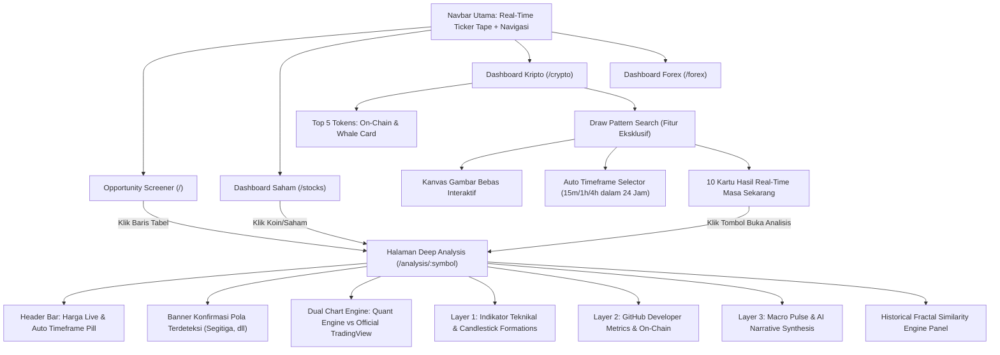

# ATRED Platform — Spesifikasi Desain Antarmuka & Pengalaman Pengguna (UI/UX Specification)

Dokumen ini disusun sebagai panduan komprehensif sistem antarmuka, arsitektur informasi, alur interaksi pengguna (*user journey*), prinsip desain visual, dan spesifikasi komponen pada platform **ATRED (Multi-Asset Quantitative Trading Analysis Platform)** untuk diserahkan kepada tim UI/UX dan desainer produk.

---

## 1. Ringkasan Eksekutif Produk

### 1.1 Visi Produk
**ATRED** adalah platform analitik dan penyaring peluang perdagangan kuantitatif terpadu (*Multi-Asset Screener & Deep Analysis Engine*) untuk tiga pasar utama: **Saham (Stocks)**, **Kripto (Crypto)**, dan **Forex (FX)**. 

Platform ini menggabungkan presisi algoritma kuantitatif (Python, SciPy, NumPy) dengan antarmuka web modern yang cepat, estetis, interaktif, dan informatif secara visual tanpa membebani kognitif pengguna (*cognitive overload*).

### 1.2 Target Persona Pengguna
1. **Active Crypto & Forex Trader**: Membutuhkan eksekusi cepat, deteksi pola grafik real-time dalam 24 jam terakhir, dan pemindaian momentum intraday.
2. **Quantitative & Technical Swing Trader**: Mengandalkan konvergensi indikator teknikal (RSI, ATR, MACD), proyeksi fraktal kemiripan historis, serta level Take Profit (TP) & Stop Loss (SL) matematis.
3. **Fundamental & On-Chain Investor**: Memeriksa metrik aktivitas developer (GitHub commit & PRs), audit konsentrasi *Whale* di blockchain, dan rangkuman narasi AI multi-layer.

---

## 2. Prinsip Desain & Design System

### 2.1 Tema Visual: Modern Dark Fintech Aesthetic
Platform mengadopsi tema gelap (*sleek dark mode*) kelas institusional (*Bloomberg / TradingView style*) dengan aksen warna neon yang fungsional dan terkalibrasi tinggi.

| Token Warna | Nilai HEX / CSS | Peran & Penggunaan |
| :--- | :--- | :--- |
| **Background Utama** | `#080d1a` / `slate-950` | Latar belakang kanvas aplikasi, minim pantulan cahaya, nyaman untuk trading lama |
| **Card Surface** | `rgba(15, 23, 42, 0.6)` / `slate-900/60` | Kontainer kartu, border halus `slate-800/80` dengan backdrop blur |
| **Primary Brand** | `#6366f1` / `indigo-500` | Warna aksen brand, tombol aksi utama, kanvas gambar, fokus interaktif |
| **Bullish / Profit** | `#10b981` / `emerald-400` | Kenaikan harga (+), sinyal Bullish, probabilitas naik tinggi, level TP, badge Live |
| **Bearish / Loss** | `#f43f5e` / `rose-400` | Penurunan harga (-), sinyal Bearish, probabilitas turun, level Stop Loss (SL) |
| **Live Price Curve** | `#f59e0b` / `amber-400` | Garis grafik harga pasar terkini (masa sekarang) pada kartu hasil pencarian pola |
| **User Drawn Probe** | `#818cf8` / `indigo-400` | Garis grafik pola yang digambar langsung oleh pengguna |
| **Projection Curve** | `#34d399` (naik) / `#f87171` (turun) | Garis putus-putus (*dashed line*) proyeksi arah lilin ke masa depan (12 bar) |
| **Neutral / Muted** | `#94a3b8` / `slate-400` | Label sekunder, metadata tanggal, teks bantuan |

### 2.2 Tipografi
- **Font Utama Antarmuka**: `Inter, system-ui, sans-serif` — bersih, sangat mudah dibaca (*legibility*) pada berbagai ukuran layar.
- **Font Angka & Kuantitatif**: `JetBrains Mono, Menlo, monospace` — digunakan pada seluruh angka harga, persentase perubahan, rasio keuangan, dan timestamp agar karakter angka sejajar vertikal (*tabular figures*).

### 2.3 Layout & Responsivitas Widescreen
- **Batas Maksimal Kontainer**: `max-w-[1720px]` (menggantikan batas `max-w-7xl` lama).
- **Optimalisasi Layar Laptop 15.6 Inci (1536x864 px & 1920x1080 px)**: Konten mengisi 90–95% lebar layar secara proporsional dengan padding tepi yang elegan (`xl:px-10`), mencegah layout terasa "sempit/kekecilan" seperti tablet.
- **Breakpoint Grid Responsif**:
  - **Mobile (<640px)**: 1 kolom penuh, kanvas gambar kompak (`h-44`), scroll horizontal pada tab timeframe.
  - **Tablet (640px–1024px)**: 2 kolom kartu hasil pencarian.
  - **Laptop 15.6" (1024px–1536px)**: 3 kolom kartu hasil pencarian (`gap-5`), kanvas tinggi lega (`h-72` sampai `h-80`).
  - **Desktop Ultrawide (>1536px)**: 4 kolom kartu hasil pencarian dengan sparkline lebar dan tajam (Retina HiDPI).

---

## 3. Arsitektur Informasi & Peta Halaman

---

## 4. Spesifikasi Fitur Utama

### 4.1 Draw Pattern Search (Fitur Eksklusif Halaman Kripto)

Fitur inovatif di mana pengguna dapat **menggambar bentuk grafik apa saja** di kanvas interaktif, dan sistem akan langsung **memindai koin kripto di masa sekarang (real-time)** yang sedang membentuk pola serupa.

#### A. Kanvas Menggambar Interaktif (`DrawPatternCanvas.jsx`)
- **Perilaku Kanvas**: Menerima input sentuhan (*touch*) dan kursor mouse (*drag*). Setiap titik dinormalisasi ke rentang $[0..1]$ sumbu X dan Y.
- **Density Grid Dinamis**: Grid garis latar belakang menyesuaikan secara proporsional terhadap rasio layar (`W / 110` kolom, `H / 45` baris).
- **Glow & Kuas**: Goresan garis kuas berwarna indigo cerah dengan efek *neon bloom/glow* (`shadowBlur: 16px`), diakhiri titik indikator berdenyut (*pulsing dot*) di titik terakhir.
- **Tombol Kontrol**:
  - `Clear`: Menghapus kanvas dan mengatur ulang status.
  - `Cari Pola Serupa`: Tombol utama dengan efek loading spinner saat pencarian berlangsung.

#### B. Sistem Timeframe Otomatis (`⚡ Auto / 24 Jam`)
- **Filosofi UX**: Pengguna **tidak perlu bingung memilih timeframe secara manual**. Sistem secara otomatis menguji rentang lilin tercepat (**15 Menit**, **1 Jam**, dan **4 Jam**) yang merefleksikan aksi pasar **24 jam terakhir**.
- **Logika Sistem**: Untuk setiap koin, algoritma memilih timeframe yang paling presisi menghasilkan skor kecocokan tertinggi.

#### C. Algoritma Pengenalan Pola Geometris (`classify_pattern_shape`)
Sistem mengklasifikasikan geometri yang digambar pengguna ke dalam nama pola pasar finansial standar:
- **Segitiga Simetris (*Symmetrical Triangle*)**: Garis puncak menurun dan garis lembah menaik secara konvergen.
- **Segitiga Naik (*Ascending Triangle*)**: Garis resistensi atas datar dengan lembah menaik (*higher lows*).
- **Segitiga Turun (*Descending Triangle*)**: Garis support bawah datar dengan puncak menurun (*lower highs*).
- **Pola W (*Double Bottom*)**: Dua lembah sejajar dengan pantulan tengah kuat (sinyal *Bullish Reversal*).
- **Pola M (*Double Top*)**: Dua puncak sejajar (sinyal *Bearish Reversal*).
- **Tren Naik (*Bullish Breakout*)** / **Tren Turun (*Bearish Reversal*)**.

#### D. Kartu Hasil Pencarian Masa Sekarang (`PatternCard.jsx`)
- **Pola Real-Time Masa Sekarang**: Sistem tidak lagi menampilkan potongan masa lampau (2018–2020), melainkan lilin yang berakhir pada harga live hari ini.
- **Anatomi Kartu**:
  1. **Header**: Nomor ranking (1–10), simbol token, nama koin, dan badge timeframe otomatis (misal: `⚡ 15 Menit (24 Jam)`).
  2. **Badge Nama Pola**: Badge berikon kilau (`✨ Pola: Segitiga Simetris (Symmetrical Triangle)`).
  3. **Harga Pasar Terkini**: Nilai harga live (misal `$76,927.40`), persentase perubahan 24h, dan badge hijau berdenyut **`● Masa Sekarang (Live)`**.
  4. **Rentang Waktu Aktual**: `Mulai: YYYY-MM-DD → Hari Ini (YYYY-MM-DD)`.
  5. **Mini Sparkline Overlay Retina**:
     - 🟠 **Garis Oranye**: Harga Saat Ini (Live Market).
     - 🟣 **Garis Ungu/Indigo**: Pola yang digambar pengguna.
     - 🟢 **Garis Putus-Putus**: Proyeksi pergerakan harga 12 bar ke depan.
  6. **Bar Skor Kemiripan**: Persentase kemiripan ($0-100\%$) dengan pewarnaan dinamis (Hijau $\ge 70\%$, Oranye $\ge 50\%$, Ungu $<50\%$).
  7. **Verdict & Probabilitas Naik**: Badge rekomendasi (`BULLISH` / `BEARISH` / `NEUTRAL`) dan nilai $P(\text{Naik})$.
  8. **Tombol Aksi Utama**: **`Buka Analisis Timeframe 15m (24 Jam) →`**.

---

### 4.2 Halaman Analisis Detail Terintegrasi (`AssetDetail.jsx`)

Saat pengguna mengklik tombol pada kartu hasil pencarian, sistem langsung memuat halaman analisis mendalam dengan konfigurasi otomatis yang konsisten:

#### A. Pemilihan Timeframe Otomatis
- Parameter URL `?timeframe=15m&pattern=...` dibaca secara instan.
- Tombol timeframe pada chart (**`15M`**) langsung aktif otomatis berwarna biru tanpa memerlukan input ulang dari pengguna.
- Seluruh lilin candlestick dimuat dalam resolusi 15 menit (mencakup 24–48 jam terakhir).

#### B. Banner Konfirmasi Pola Terdeteksi
Terletak tepat di atas grafik kuantitatif:
- Menampilkan nama pola yang terdeteksi (*contoh: Segitiga Simetris*).
- Menampilkan badge hijau berdenyut **`Live 24 Jam`**.
- Menampilkan skor kemiripan (misal **`58%`**).
- Keterangan informatif: *"Sistem otomatis memilih timeframe 15M mengikuti pola pergerakan harga yang diinput. Lilin candlestick di bawah memuat pergerakan live untuk mengonfirmasi formasi."*

#### C. Grafik Candlestick Kuantitatif Bersih (`TradingViewChart.jsx`)
- **Tampilan Bersih Tanpa Polusi Garis**: Garis Support dan Resistance telah dihilangkan sesuai permintaan pengguna agar grafik lilin candlestick tampak luas, fokus, dan tidak tumpang tindih (*clutter-free*).
- **Indikator Aktif**:
  - Toggle **EMA 20** (garis oranye amber halus) dan **EMA 50** (garis ungu).
  - Garis horizontal dinamis **Target Price (TP hijau putus-putus)** dan **Stop Loss (SL merah putus-putus)** berbasis kalkulasi volatilitas ATR 14.
  - Header data OHLCV interaktif saat kursor melayang di atas lilin (*crosshair inspection*).

#### D. Panel Analisis Pendukung
- **IndicatorsPanel**: Nilai RSI (14) dengan status *Overbought/Oversold*, ATR volatilitas, MACD Histogram, deteksi anomali volume (>1.5x SMA), dan formasi pola candlestick (*Engulfing, Hammer, Doji*).
- **DevActivityChart**: Indeks aktivitas developer repositori resmi (Commit bulanan, Kontributor aktif, Pull Requests).
- **AISummaryCard**: Sintesis narasi eksekutif AI terstruktur (Ikhtisar, Skenario Bull/Bear, Sentimen Makro).

---

## 5. Matriks Status Komponen UI (States Guide)

Untuk memastikan pengalaman pengguna yang mulus, tim UI/UX perlu mendesain status berikut untuk setiap komponen:

| Komponen | Default State | Hover / Active State | Loading State | Empty / Error State |
| :--- | :--- | :--- | :--- | :--- |
| **Canvas Gambar** | Latar gelap dengan grid halus, teks instruksi *"Gambar pola di sini..."* | Kursor kuas crosshair, goresan ber-glow neon, titik ujung pulsing | Input dinonaktifkan sementara | Tombol Clear membersihkan kanvas ke kondisi semula |
| **Tombol Timeframe** | Background abu-abu transparan, border slate halus | Biru indigo menyala, border terang, scale 0.98 saat ditekan | Skeleton pulsing | Jika data timeframe tidak tersedia, fallback ke timeframe terdekat |
| **Kartu Hasil Koin** | Border slate-800, sparkline transparan | Border indigo ber-glow, elevasi bayangan halus, garis aksen atas menyala | Card skeleton dengan shimmer wave animation | Banner notifikasi *"Pola serupa belum ditemukan, coba ubah bentuk gambar"* |
| **Tombol Aksi Analisis** | Indigo transparan (`bg-indigo-600/20`), teks indigo | Background lebih terang, teks putih, ikon panah bergeser ke kanan 2px | Spinner putar kecil | Dinonaktifkan (`disabled:opacity-40`) jika data belum siap |

---

## 6. Rekomendasi Desain untuk Tim UI/UX di Figma

1. **Gunakan Spacing Skala 8-Point**: Padding kontainer menggunakan kelipatan 8px (`p-4` = 16px, `p-6` = 24px, `p-8` = 32px).
2. **Radius Sudut Modern**: Gunakan `rounded-2xl` (16px) untuk kartu utama dan modal, serta `rounded-xl` (12px) untuk tombol dan input.
3. **Pencahayaan & Aksentuasi Visual**: Hindari warna latar belakang hitam pekat `#000000`. Gunakan deep blue-navy `#080d1a` dengan efek *radial gradient ambient glow* ungu/indigo di latar belakang untuk nuansa premium fintech.
4. **Kejelasan Hierarki Informasi**:
   - Level 1: Simbol Koin & Harga Terkini (Ukuran terbesar, font-mono tebal).
   - Level 2: Nama Pola Terdeteksi & Timeframe Badge (Warna kontras tinggi).
   - Level 3: Grafik Sparkline & Skor Kemiripan (Visual representatif).
   - Level 4: Metadata tanggal & teks bantuan (Warna slate redup).

---

## 7. Lokasi Berkas Kode Terkait (File References)

- **Komponen Kanvas Gambar**: [DrawPatternCanvas.jsx](file:///d:/Atred/frontend/src/components/charts/DrawPatternCanvas.jsx)
- **Komponen Kartu Hasil Pencarian**: [PatternSearchResults.jsx](file:///d:/Atred/frontend/src/components/charts/PatternSearchResults.jsx)
- **Dashboard Kripto Terpadu**: [CryptoDashboard.jsx](file:///d:/Atred/frontend/src/pages/CryptoDashboard.jsx)
- **Halaman Analisis Detail**: [AssetDetail.jsx](file:///d:/Atred/frontend/src/pages/AssetDetail.jsx)
- **Komponen Grafik Candlestick**: [TradingViewChart.jsx](file:///d:/Atred/frontend/src/components/charts/TradingViewChart.jsx)
- **Engine Deteksi Pola & Kemiripan**: [similarity_engine.py](file:///d:/Atred/backend/app/services/similarity_engine.py)
- **API Endpoint Router Kripto**: [crypto.py](file:///d:/Atred/backend/app/api/routers/crypto.py)
