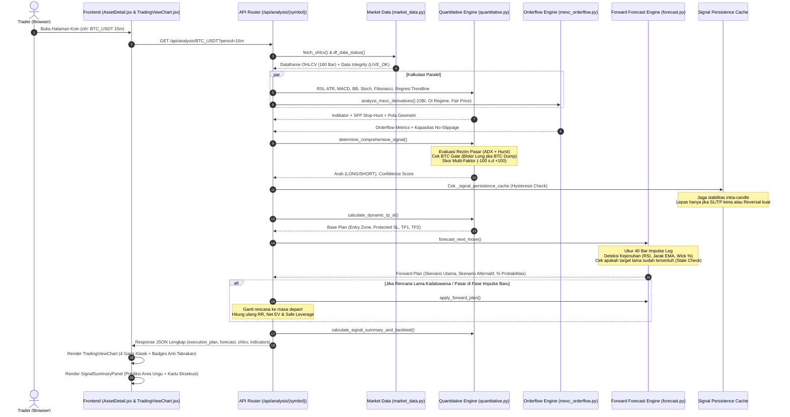

# DOKUMENTASI LENGKAP ARSITEKTUR KODE & METODOLOGI ANALISA SISTEM ATRED

> **Klasifikasi:** Dokumentasi Resmi Kode Sistem & Panduan Analisa Kuantitatif  
> **Berkas:** `abouttred.md`  
> **Target Analisa:** Seluruh File Kode Sumber (`backend/app/core/`, `backend/app/services/`, `backend/app/api/`, `frontend/src/`)  
> **Fokus Utama:** Mekanisme Kerja Nyata Engine Analisa Teknikal, Forward Forecasting, dan Eksekusi Anti-Stop-Hunt

---

## DAFTAR ISI

1. [Ikhtisar Sistem & Filosofi Berbasis Kode (*Code-First Reality*)](#1-ikhtisar-sistem--filosofi-berbasis-kode-code-first-reality)
2. [Peta Alur Kerja Sistem (Pipeline Eksekusi Kode End-to-End)](#2-peta-alur-kerja-sistem-pipeline-eksekusi-kode-end-to-end)
3. [Deep-Dive: Engine Analisa Teknikal Kuantitatif (`quantitative.py`)](#3-deep-dive-engine-analisa-teknikal-kuantitatif-quantitativepy)
   - 3.1. Algoritma Deteksi Pivot Ekstrem & Regresi Trendline Bebas Outlier
   - 3.2. Indikator Standar Industri & Stochastic Slow PineScript (14, 3, 3)
   - 3.3. Swing Failure Pattern (SFP) & Stop-Hunt Detector
   - 3.4. Detektor Rezim Pasar Adaptif: ADX(14) & Hurst Exponent
   - 3.5. BTC Macro Gatekeeper & Relative Strength Alt/BTC
   - 3.6. Sistem Penilaian Multi-Faktor Komprehensif (-100 s.d +100)
4. [Forward Forecast Engine: Prediksi Masa Depan & Solusi Sinyal Basi (`forecast.py`)](#4-forward-forecast-engine-prediksi-masa-depan--solusi-sinyal-basi-forecastpy)
   - 4.1. Anatomi Masalah Sinyal Ketinggalan Zaman (*Stale Signal*)
   - 4.2. Pengukuran Leg Impulse & Skor Kejenuhan Nyata (*Exhaustion Scoring*)
   - 4.3. Klasifikasi 6 Fase Pasar
   - 4.4. Proyeksi Jalur Skenario Utama vs Alternatif
   - 4.5. Perumusan Rencana Trading Maju (*Forward Trade Plan*)
   - 4.6. Cache Persistensi & Histeresis (Mencegah Sinyal Bolak-Balik)
5. [Logika Eksekusi Anti-Stop-Hunt & Manajemen Risiko](#5-logika-eksekusi-anti-stop-hunt--manajemen-risiko)
   - 5.1. Maker Limit Entry 0% Fee di Zona Likuiditas Diskon
   - 5.2. Protected Stop Loss Berbasis MEXC `FAIR_PRICE` (Kebal *Scam Wick*)
   - 5.3. Split Take-Profit: TP1 (50% + Pindah SL ke BEP) dan TP2 Runner
   - 5.4. Formula Risk:Reward Otomatis & Net Expected Value (Net EV)
6. [Engine Pendukung Analisa: Orderflow, Fraktal, & Pola Geometri](#6-engine-pendukung-analisa-orderflow-fraktal--pola-geometri)
   - 6.1. Orderflow & Derivatif MEXC (`mexc_orderflow.py`)
   - 6.2. Deteksi Pola Geometris & Candlestick (`pattern_engine.py`)
   - 6.3. Historical Similarity Engine / Fraktal DTW (`similarity_engine.py`)
   - 6.4. Kanvas Pencarian Pola Gambaran Tangan (`DrawPatternCanvas.jsx`)
7. [Visualisasi Frontend & Arsitektur Chart TradingView (`TradingViewChart.jsx`)](#7-visualisasi-frontend--arsitektur-chart-tradingview-tradingviewchartjsx)
   - 7.1. Hirarki Visual & Sistem Warna Semantik Konsisten
   - 7.2. Algoritma Anti-Tabrakan Label Sisi Kanan (*Badge Stacking*)
   - 7.3. `autoscaleInfoProvider` (Mencegah Garis SL/TP Terpotong Layar)
   - 7.4. Panel Stochastic Slow Bawah & Mode Tampilan Simple vs Detail
8. [Panduan Praktis Trader: Langkah Demi Langkah Melakukan Analisa di ATRED](#8-panduan-praktis-trader-langkah-demi-langkah-melakukan-analisa-di-atred)
9. [Glosarium Lengkap Variabel & Kontrak Data API](#9-glosarium-lengkap-variabel--kontrak-data-api)

---

## 1. IKHTISAR SISTEM & FILOSOFI BERBASIS KODE (*CODE-FIRST REALITY*)

Sistem **ATRED** (*Advanced Quantitative Trading & Predictive Intelligence Platform*) dibangun dengan arsitektur komputasi terdistribusi:
- **Backend Core**: Python 3.11+ yang memanfaatkan pustaka saintifik `numpy`, `scipy.signal`, `scipy.spatial`, `pandas`, dan framework asinkron `fastapi`.
- **Frontend Core**: React 18, Vite, TailwindCSS, dan library rendering grafik finansial institusional `lightweight-charts` (TradingView).

### Prinsip Utama Penulisan Kode:
1. **100% Deterministik Matematis (Tanpa Halusinasi Angka):**
   Di seluruh basis kode (`quantitative.py`, `forecast.py`, `pattern_engine.py`, `mexc_orderflow.py`), **tidak ada satupun angka harga, stop loss, take profit, atau level pivot yang digenerate oleh AI**. Semua angka adalah turunan langsung dari fungsi matematika teruji.
2. **Zero-Slippage & Anti-Fee Bleeding:**
   Engine dirancang secara spesifik untuk meminimalkan *taker fee* dan *slippage*. Posisi diarahkan menggunakan **Post-Only Maker Limit Order** (0% fee di bursa MEXC).
3. **Ketahanan Data Real-Time & Circuit Breaker:**
   Sistem memvalidasi setiap candle. Jika umur data melampaui 60 detik atau terjadi deviasi harga abnormal antara bursa spot dan derivatif perpetual (*basis dislocation*), sistem secara otomatis mengaktifkan status `HALTED_DATA_STALE` dan menolak merilis sinyal eksekusi.

---

## 2. PETA ALUR KERJA SISTEM (PIPELINE EKSEKUSI KODE END-TO-END)

Ketika pengguna membuka detail suatu koin (misalnya `BTC_USDT` timeframe `15m`), berikut adalah rantai eksekusi kode yang terjadi di backend dan frontend:



---

## 3. DEEP-DIVE: ENGINE ANALISA TEKNIKAL KUANTITATIF (`quantitative.py`)

File `backend/app/core/quantitative.py` (1.731 baris kode) adalah jantung kalkulasi matematis ATRED. Berikut adalah bedah algoritma utamanya:

### 3.1. Algoritma Deteksi Pivot Ekstrem & Regresi Trendline Bebas Outlier
- **Ekstraksi Pivot Dinamis (`detect_pivots`):**
  Menggunakan fungsi `scipy.signal.find_peaks` dengan jarak minimum `distance = max(3, len(df) // 25)`. Mengidentifikasi puncak lokal (*high peaks*) dan lembah lokal (*low peaks*) yang signifikan.
- **Pembersihan Outlier Sumbu Panjang (`_robust_line_fit`):**
  Garis tren konvensional sering rusak karena satu candle berekor panjang (*flash spike*). ATRED menghitung jarak residual setiap titik terhadap garis regresi linier `np.polyfit(x, y, 1)`:
  $$\text{Residual}_i = |y_i - (\text{slope} \cdot x_i + \text{intercept})|$$
  Jika $\text{Residual}_i > 1.8 \times \text{ATR}$, titik tersebut **dibuang sebagai anomali manipulasi**, dan garis diregresi ulang dengan titik-titik yang valid.
- **Garis Saluran Sejajar (`calculate_trendlines`):**
  Menghasilkan koordinat garis atas (*upper resistance*) dan garis bawah (*lower support*) yang digambar langsung di kanvas grafik.

---

### 3.2. Indikator Standar Industri & Stochastic Slow PineScript (14, 3, 3)
Kalkulasi indikator di ATRED dipastikan 100% identik dengan formula TradingView / PineScript:
- **RSI (Wilder's Smoothing):** Menggunakan eksponensial moving average Wilder pada gain dan loss 14 periode.
- **ATR (Average True Range 14):** 
  $$\text{TR} = \max(\text{High} - \text{Low}, |\text{High} - \text{Close}_{\text{prev}}|, |\text{Low} - \text{Close}_{\text{prev}}|)$$
  ATR digunakan sebagai satuan volatilitas universal dalam menentukan jarak Stop Loss dan Take Profit.
- **Stochastic Slow (14, 3, 3):**
  Dihitung dalam fungsi `calculate_stochastic` dan `analyze_stochastic`:
  1. $\text{Raw } \%K = \frac{\text{Close} - \text{LowestLow}_{14}}{\text{HighestHigh}_{14} - \text{LowestLow}_{14}} \times 100$
  2. $\%K = \text{SMA}(\text{Raw } \%K, 3)$
  3. $\%D = \text{SMA}(\%K, 3)$
  Status bias ditentukan: `STRONG_BULLISH` jika $\%K > \%D$ dan $\%K < 30$; `STRONG_BEARISH` jika $\%K < \%D$ dan $\%K > 70$.

---

### 3.3. Swing Failure Pattern (SFP) & Stop-Hunt Detector
Diimplementasikan dalam fungsi `detect_sfp_stop_hunt(df, lookback=35)`:
- **Bullish SFP (Indikasi Beli / Jebakan Penjual):**
  Harga terendah candle saat ini menembus di bawah Swing Low sebelumnya ($\text{Low}_t < \text{SwingLow}_{\text{prev}}$), **tetapi harga penutupan berhasil kembali di atas level tersebut** ($\text{Close}_t > \text{SwingLow}_{\text{prev}}$) disertai sumbu bawah panjang ($\text{LowerWick}_t \ge 0.45 \times \text{Range}_t$) dan lonjakan volume.
- **Bearish SFP (Indikasi Jual / Upthrust Likuiditas):**
  Harga tertinggi candle saat ini menembus di atas Swing High sebelumnya, tetapi penutupan candle kembali di bawah Swing High disertai sumbu atas panjang ($\text{UpperWick}_t \ge 0.45 \times \text{Range}_t$).
- **Bobot Skor:** SFP memberikan dorongan instan **+35 poin (Bullish)** atau **-35 poin (Bearish)** pada skor konsensus arah.

---

### 3.4. Detektor Rezim Pasar Adaptif: ADX(14) & Hurst Exponent
Diimplementasikan dalam `detect_market_regime(df)`:
Untuk mengatasi kegagalan indikator teknikal (misal: RSI terus overbought saat tren sangat kuat, atau Moving Average sering false breakout saat sideways), sistem menghitung:
1. **ADX 14 & Directional Movement (+DI, -DI):** Mengukur kekuatan tren.
2. **Hurst Exponent ($H$):** Mengukur persistensi deret waktu melalui analisis Rescaled Range ($R/S$).
   - $H > 0.55$: Pasar bersifat persisten / *trending*.
   - $H < 0.45$: Pasar bersifat mean-reverting / *ranging*.

**Adaptasi Bobot Rezim Pasar:**
- **Rezim `TRENDING` ($ADX > 25$ & $H > 0.55$):**
  Bobot 70% Trend-Following (EMA, Pola Kanal, Breakout), Bobot 30% Oscillator.
  *Kritikal:* Sistem **mematikan sinyal counter-trend oscillator** (`disable_counter_trend_oscillator = True`). Trader tidak akan disuruh Short hanya karena RSI jenuh saat tren naik kuat!
- **Rezim `MEAN_REVERTING` ($ADX < 20$ atau $H < 0.45$):**
  Bobot 75% Oscillator & SFP, Bobot 25% Trend. Sistem memprioritaskan pembalikan arah di level ekstrem Bollinger Bands dan Fibonacci.
- **Rezim `TRANSITIONAL`:**
  Bobot seimbang 50% Trend / 50% Oscillator.

---

### 3.5. BTC Macro Gatekeeper & Relative Strength Alt/BTC
Diimplementasikan dalam `check_btc_gate(df, symbol)`:
Bitcoin adalah indeks pasar utama kripto. Membeli altcoin saat Bitcoin sedang ambruk adalah bunuh diri portofolio:
1. Sistem mengambil data candle 1 Jam `BTC_USDT` secara real-time (di-cache 30 detik).
2. Menghitung **Relative Strength Altcoin terhadap BTC** dalam 12 bar terakhir:
   $$\text{RS}_{\text{Alt/BTC}} = \text{Return}_{12}(\text{Alt}) - \text{Return}_{12}(\text{BTC})$$
3. **Logika Proteksi:**
   Jika BTC sedang mengalami dump keras ($\text{Return}_{1\text{h}} < -1.5\%$ atau $\text{Return}_{12\text{bar}} < -3.5\%$ dan $\text{Close} < \text{EMA}_{20}$):
   - Jika $\text{RS}_{\text{Alt/BTC}} > +2.0\%$: Berstatus `PASS_DECOUPLED_LEADER` (Koin sangat kuat dan bergerak independen, Long diizinkan).
   - Selain itu: Berstatus **`BLOCKED_BY_BTC_DUMP`**. Sistem **memblokir seluruh sinyal LONG** pada altcoin tersebut dan memotong skor keyakinan sebanyak 20 poin.

---

### 3.6. Sistem Penilaian Multi-Faktor Komprehensif (-100 s.d +100)
Diimplementasikan dalam `determine_comprehensive_signal`:
Menggabungkan seluruh faktor menjadi satu skor konsensus terpadu:
- **Pola Geometri**: $\pm 25$ hingga $\pm 35$ poin.
- **Struktur Rerata Bergerak (EMA 20 vs EMA 50)**: $\pm 15$ hingga $\pm 28$ poin.
- **MACD Histogram**: $\pm 12$ poin.
- **Struktur Fibonacci Impulse**: $\pm 15$ poin.
- **Osilator Momentum (RSI + Stoch 14 3 3)**: $\pm 12$ hingga $\pm 24$ poin.
- **Swing Failure Pattern (SFP)**: $\pm 35$ poin.
- **Candlestick Reversal Formations**: $\pm 10$ poin.
- **Orderflow Imbalance (Layer 2)**: Bobot tambahan $\pm 25\%$.

**Klasifikasi Akhir:**
- $\text{Score} \le -40$: `Strong Bearish` (Arah: SHORT)
- $-40 < \text{Score} \le -12$: `Bearish` (Arah: SHORT)
- $-11 \le \text{Score} \le +11$: `Neutral Zone` (Ditentukan oleh orientasi tren makro EMA 20 vs EMA 50 untuk mencegah pembalikan sinyal liar)
- $+12 \le \text{Score} < +40$: `Bullish` (Arah: LONG)
- $\text{Score} \ge +40$: `Strong Bullish` (Arah: LONG)

---

## 4. FORWARD FORECAST ENGINE: PREDIKSI MASA DEPAN & SOLUSI SINYAL BASI (`forecast.py`)

File `backend/app/core/forecast.py` (713 baris kode) diciptakan untuk memecahkan kelemahan mendasar pada sistem trading otomatis konvensional: **sinyal yang menunjuk ke fase yang sudah selesai**.

### 4.1. Anatomi Masalah Sinyal Ketinggalan Zaman (*Stale Signal*)
Perhatikan skenario nyata di pasar:
1. Sebuah koin melonjak (*pump*) vertikal sebesar 25% dalam 3 candle terakhir hingga menyentuh harga $0.0829$.
2. Engine trading konvensional yang kaku mengevaluasi rentang swing 45 candle ke belakang:
   - Swing low berada di $0.0650$ (terjadi 20 candle lalu).
   - Swing high berada di $0.0829$ (candle saat ini).
3. Engine lama kemudian menyimpulkan: *"Sinyal Long! Entry di 0.0720, Take Profit di 0.0829."*
4. **Masalah Besar:** Harga saat ini **sudah berada di 0.0829!** Pengguna diperintahkan membeli di harga yang sudah lewat dengan target TP yang sudah disentuh! Jika pengguna memaksakan beli sekarang, pengguna membeli tepat di puncak sebelum harga terkoreksi tajam.

---

### 4.2. Pengukuran Leg Impulse & Skor Kejenuhan Nyata (*Exhaustion Scoring*)
Fungsi `forecast_next_move(df, base_direction, base_plan, timeframe, horizon_bars=12)` membedah anatomi pergerakan terkini:
1. **Identifikasi Leg Impulse Terakhir (40 Bar Terakhir Termasuk Live Candle):**
   - Menemukan titik awal absolut (`start_price`) dan titik ekstrem terbaru (`end_price`).
   - Menghitung rentang impulse $\text{Leg} = |\text{end\_price} - \text{start\_price}|$ dalam kelipatan normal ATR (`leg_atr`).
   - Menghitung seberapa jauh harga telah melakukan retracement sejak puncak (`retrace_now`).
2. **Evaluasi Titik Jenuh Kuantitatif (Exhaustion Points):**
   - Jarak Harga dari EMA 20: Jika harga berjarak $\ge 3\times$ ATR dari EMA 20 $\rightarrow$ +2.0 poin reversal (Overextended).
   - RSI 14 Ekstrem: Jika RSI $\ge 75$ (setelah pump) atau $\le 25$ (setelah dump) $\rightarrow$ +2.0 poin reversal.
   - Stochastic %K Ekstrem: Jika %K $\ge 85$ $\rightarrow$ +1.5 poin reversal.
   - Klimaks Volume: Jika volume 3 candle terakhir $\ge 2.5\times$ rata-rata volume $\rightarrow$ +1.0 poin reversal.
   - Sumbu Penolakan (*Rejection Wick*): Jika sumbu atas (setelah pump) $\ge 40\%$ dari total range lilin $\rightarrow$ +1.5 poin reversal.
   - Divergensi RSI Bearish/Bullish $\rightarrow$ +2.0 poin reversal.
3. **Pemeriksaan Statistik Base-Rate Historis Koin:**
   Melakukan simulasi cepat pada data historis koin itu sendiri: setiap kali terjadi impulse $\ge 3\times$ ATR dengan RSI ekstrem, apa yang terjadi lebih dulu dalam 12 candle ke depan: koreksi Fibonacci 0.382 atau ekspansi lanjutan? Probabilitas empiris ini diintegrasikan ke skor reversal.

---

### 4.3. Klasifikasi 6 Fase Pasar
Berdasarkan metrik di atas, pasar diklasifikasikan ke dalam salah satu dari 6 fase presisi:
1. `EXHAUSTION_AFTER_PUMP`: Jenuh Setelah Pump (Rawan Koreksi Turun).
2. `EXHAUSTION_AFTER_DUMP`: Jenuh Setelah Dump (Rawan Pantulan Naik).
3. `MOMENTUM_CONTINUATION_UP`: Momentum Naik Masih Kuat (Retest dangkal lalu lanjut).
4. `MOMENTUM_CONTINUATION_DOWN`: Momentum Turun Masih Kuat.
5. `CONSOLIDATION_AFTER_IMPULSE`: Konsolidasi Setelah Impulse (Sideways di rentang atas).
6. `PULLBACK_AT_ZONE`: Koreksi Sehat Sedang Menguji Golden Area Fibonacci (0.382–0.5).

---

### 4.4. Proyeksi Jalur Skenario Utama vs Alternatif
Sistem memproyeksikan lintasan koordinat N candle ke depan (`bars_ahead`, `price`) yang divisualisasikan pada chart:
- **Skenario Utama (Primary Scenario):**
  Jalur dengan probabilitas tertinggi. Misalnya pada fase `EXHAUSTION_AFTER_PUMP`:
  - Arah Bias: `DOWN` (Koreksi)
  - Judul: *"Koreksi turun dulu ke Fib 0.382–0.5, lalu memantul"*
  - Target Area: Rentang harga Fib 0.382 s.d 0.5.
  - Probabilitas: Misalnya 71%.
- **Skenario Alternatif (Alternate Scenario):**
  Jalur kontinjensi jika skenario utama gagal:
  - Arah Bias: `UP` (Ekstensi)
  - Judul: *"Lanjut naik menembus swing high menuju Fib Ext 1.272"*
  - Probabilitas: $100\% - 71\% = 29\%$.

---

### 4.5. Perumusan Rencana Trading Maju (*Forward Trade Plan*)
Jika setup lama terdeteksi *stale* atau pasar berada di fase impulse/exhaustion baru, fungsi `apply_forward_plan()` menggantikan level lama dengan rencana masa depan:
- **Untuk Fase Jenuh Pump (`EXHAUSTION_AFTER_PUMP`):**
  - **TIDAK PERNAH MENYARANKAN BELI DI HARGA LIVE!**
  - Sistem membuat rencana: **Limit Buy di Zona Retrace Fibonacci 0.382–0.5**, dengan Protected SL di bawah Fib 0.618, serta TP1 di puncak ayunan lama dan TP2 di ekstensi 1.272 (keduanya berada di masa depan!).
  - Atau, jika konfirmasi pembalikan sangat kuat (divergensi jelas & rejection wick $> 45\%$), membuat rencana: **Short Reversal dengan syarat konfirmasi candle close menembus low bar sebelumnya**.

---

### 4.6. Cache Persistensi & Histeresis (Mencegah Sinyal Bolak-Balik)
Diatur dalam `_signal_persistence_cache` pada router `analysis.py`:
- Kunci Cache: `(symbol, timeframe)`.
- Menyimpan arah trading aktif, harga SL, TP1, dan TP2.
- **Aturan Evaluasi:**
  Selama lilin 15 menit atau 1 jam sedang berjalan, sinyal **TIDAK AKAN BERGANTI-GANTI** hanya karena osilasi tick tipis. Setup aktif hanya dilepas dan dihitung ulang jika:
  1. `is_sl_hit`: Harga live menembus level Stop Loss.
  2. `is_tp1_hit` atau `is_tp2_hit`: Target fase tersebut telah tercapai.
  3. `is_strong_reversal`: Terjadi perubahan skor struktural ekstrem ($|\Delta \text{Score}| \ge 30$).

---

## 5. LOGIKA EKSEKUSI ANTI-STOP-HUNT & MANAJEMEN RISIKO

File `quantitative.py` pada fungsi `calculate_dynamic_tp_sl` merealisasikan manajemen risiko berstandar dana lindung nilai (*hedge fund*):

### 5.1. Maker Limit Entry 0% Fee di Zona Likuiditas Diskon
- Entry dihitung pada area **Optimal Trade Entry (OTE Fibonacci 0.618–0.786)** atau area penjemputan likuiditas ayunan minor:
  $$\text{Entry}_{\text{Long}} = 0.45 \times \text{SweepLow} + 0.55 \times \text{SweepHigh}$$
- Jenis order default yang disarankan adalah **Post-Only Maker Limit Order**. Menghemat biaya transaksi hingga 100% (0% fee di MEXC) dan memastikan posisi tidak pernah dibuka di area tengah tanpa konfluensi (*No-Man's Land*).

---

### 5.2. Protected Stop Loss Berbasis MEXC `FAIR_PRICE` (Kebal *Scam Wick*)
Fenomena *Stop-Loss Hunting* terjadi ketika bursa atau pasar spot melakukan transaksi kilat bervolume tipis yang membentuk jarum panjang (*wick*) untuk memicu likuidasi massal.

**Solusi Kode ATRED:**
1. **Jarak Aman Struktural:**
   Stop Loss untuk Long diwajibkan berada **DI BAWAH Major Structural Swing Low** (bukan di swing minor!) ditambah buffer volatilitas $0.45\times$ ATR:
   $$\text{SL}_{\text{Long}} = \min(\text{MajorLow} - 0.45 \times \text{ATR}, \text{EntryZoneLow} - 0.75 \times \text{ATR})$$
2. **Kepatuhan Terhadap Fair Price (Index Mark Price):**
   Level invalidasi dievaluasi terhadap harga wajar global (*Fair Price*). Penurunan sesaat pada *Last Price* akibat transaksi agresif lokal tidak akan memicu sinyal tutup posisi kecuali nilai *Fair Price* resmi menembus SL.

---

### 5.3. Split Take-Profit: TP1 (50% + Pindah SL ke BEP) dan TP2 Runner
ATRED menerapkan pembagian target bertahap:
1. **Take Profit 1 (TP1):**
   - Jarak moderat: sekitar $1.25\times$ hingga $1.5\times$ ATR dari titik entry.
   - Begitu harga menyentuh TP1: sistem menginstruksikan untuk **menutup 50% ukuran posisi**, mengunci keuntungan modal, dan **memindahkan Stop Loss posisi yang tersisa ke harga Entry (Breakeven / BEP)**.
   - Posisi kini 100% bebas dari risiko kerugian modal (*Risk-Free Trade*).
2. **Take Profit 2 (TP2 - Major Target / Runner):**
   - Mengincar batas terjauh struktur likuiditas atau target tinggi pola geometris:
     $$\text{TP2}_{\text{Long}} = \max(\text{MajorHigh}, \text{Entry} + \text{TargetHeight})$$
   - Memaksimalkan perolehan profit ketika tren besar terus berlanjut.

---

### 5.4. Formula Risk:Reward Otomatis & Net Expected Value (Net EV)
- **Kalkulasi Risk:Reward Real:**
  $$\text{Risk} = |\text{Entry} - \text{SL}|$$
  $$\text{Reward} = |\text{TP1} - \text{Entry}|$$
  $$\text{RR Ratio} = \frac{\text{Reward}}{\text{Risk}}$$
- **Net Expected Value ($\text{EV}_{\text{net}}$):**
  Memperhitungkan probabilitas historis, spread bursa, dan potongan biaya:
  $$\text{EV}_{\text{net}\%} = (P_{\text{win}} \times R_{\text{net}}) - ((1 - P_{\text{win}}) \times 1.0) - \text{Friction}$$
  Di mana $P_{\text{win}}$ diturunkan dari backtest empiris (biasanya $50\% - 75\%$).
- **Kapasitas Ukuran Posisi Tanpa Slippage (`max_zero_slippage_position_usdt`):**
  Dihitung langsung dari akumulasi 5 level kedalaman orderbook MEXC untuk mencegah trader masuk dengan ukuran modal yang merusak pasar sendiri.

---

## 6. ENGINE PENDUKUNG ANALISA: ORDERFLOW, FRAKTAL, & POLA GEOMETRI

### 6.1. Orderflow & Derivatif MEXC (`mexc_orderflow.py`)
Menganalisis data pasar derivatif perpetual USDT-M:
- **Orderbook Imbalance (OBI 20-Level):**
  Mengukur selisih volume bid dan ask pada 20 level kedalaman. OBI $> +0.20$ mengonfirmasi dominasi pembeli institusi; OBI $< -0.20$ menandakan dinding jual tebal.
- **Open Interest (OI) & Funding Rate:**
  Mendeteksi apakah pergerakan harga didorong oleh pembukaan kontrak baru (*Fresh Accumulation*) atau penutupan posisi paksa (*Liquidation Squeeze*).
- **Dislokasi Basis (Fair Price vs Last Price):**
  Jika selisih harga pasar vs harga wajar $> 0.25\%$, terindikasi distorsi likuiditas.

---

### 6.2. Deteksi Pola Geometris & Candlestick (`pattern_engine.py`)
- Memindai pola geometris segitiga (*Ascending, Descending, Symmetrical*), saluran (*Channel*), pola bendera (*Bull/Bear Flag*), serta *Double Bottom (W)* dan *Double Top (M)*.
- Mendeteksi formasi lilin pembalikan: *Hammer*, *Inverted Hammer*, *Shooting Star*, *Bullish Engulfing*, dan *Bearish Engulfing* yang terkonfirmasi oleh volume anomali.

---

### 6.3. Historical Similarity Engine / Fraktal DTW (`similarity_engine.py`)
Membandingkan 40 lilin terkini terhadap ribuan potongan candle historis koin tersebut menggunakan algoritma:
1. **Z-Score Normalization:** Menyamakan skala volatilitas harga.
2. **Dynamic Time Warping (DTW dengan Sakoe-Chiba Band):** Mengukur kemiripan bentuk kurva meskipun kecepatan waktunya berbeda.
3. **Proyeksi Kipas Probabilitas (*Fan Chart*):**
   Menghasilkan distribusi persentil hasil (P10, P25, P50 Median, P75, P90) 15 candle ke depan berdasarkan preseden historis nyata.

---

### 6.4. Kanvas Pencarian Pola Gambaran Tangan (`DrawPatternCanvas.jsx`)
Fitur unik di mana pengguna dapat menggambar garis bebas pada kanvas HTML5:
1. Mengubah goresan mouse/sentuhan menjadi 32 titik sampel terdistribusi merata (*Shape Resampling*).
2. Memindai data koin live MEXC dalam 24 jam terakhir.
3. Menemukan koin yang memiliki kemiripan bentuk grafik $> 80\%$ dan langsung membuka halaman analisis teknikalnya.

---

## 7. VISUALISASI FRONTEND & ARSITEKTUR CHART TRADINGVIEW (`TradingViewChart.jsx`)

File `frontend/src/components/charts/TradingViewChart.jsx` (1.400+ baris kode) adalah implementasi chart kustom performa tinggi:

### 7.1. Hirarki Visual & Sistem Warna Semantik Konsisten
Chart menerapkan filosofi: **Satu Warna = Satu Makna**, dapat dipahami dalam waktu $< 5$ detik:
- **Warna Biru (`#3b82f6`)**: Garis horizontal **ENTRY** (Maker 0% Limit).
- **Warna Merah (`#ef4444`)**: Garis horizontal **STOP LOSS (SL)** (Protected Fair Price).
- **Warna Hijau (`#10b981`)**: Garis horizontal **TAKE PROFIT (TP1 & TP2)**.
- **Warna Abu-abu (`#94a3b8`)**: Garis referensi teknikal (EMA 20, Level Fibonacci, Trendline).
- **Warna Ungu**: Pill indikator dan proyeksi area masa depan.

---

### 7.2. Algoritma Anti-Tabrakan Label Sisi Kanan (*Badge Stacking*)
Jika level harga berdekatan (misal Entry di 100.69 dan Fib 0.5 di 100.58), label harga pada chart biasa akan saling menumpuk dan tidak terbaca.
ATRED menerapkan algoritma pergeseran koordinat vertikal dalam fungsi `syncOverlays()`:
1. Koordinat Y setiap garis dihitung via `series.priceToCoordinate(price)`.
2. Diurutkan dari atas ke bawah.
3. Diterapkan batas jarak minimum `minBadgeDist = 23px`:
   $$\text{Jika } (y_i - y_{i-1} < 23) \implies y_i = y_{i-1} + 23$$
4. Diterapkan perataan mundur dari tepi bawah pane agar label tidak terpotong.
Hasilnya: seluruh label tersusun rapi di sisi kanan chart tanpa pernah bertabrakan.

---

### 7.3. `autoscaleInfoProvider` (Mencegah Garis SL/TP Terpotong Layar)
Masalah umum pada chart trading: ketika Stop Loss atau TP berada di luar rentang harga lilin yang terlihat, garis tersebut hilang dari layar sehingga trader tidak tahu di mana batas risikonya.
ATRED menyuntikkan `autoscaleInfoProvider` ke dalam `candleSeries`:
```javascript
candleSeries.applyOptions({
  autoscaleInfoProvider: (original) => {
    const res = original();
    // Jangkar seluruh harga SL, Entry, dan TP ke skala vertikal chart
    let minP = res.priceRange.minValue();
    let maxP = res.priceRange.maxValue();
    scaleAnchorPrices.forEach((p) => {
      minP = Math.min(minP, p);
      maxP = Math.max(maxP, p);
    });
    return { priceRange: { minValue: minP, maxValue: maxP } };
  }
});
```
Hasilnya: **Garis SL, Entry, TP1, dan TP2 dijamin 100% SELALU TERLIHAT DI LAYAR** tanpa perlu zoom-out manual!

---

### 7.4. Panel Stochastic Slow Bawah & Mode Tampilan Simple vs Detail
- **Pane Stochastic Terpisah**:
  Terletak di bagian bawah (24% tinggi chart) dengan garis %K biru dan %D oranye, lengkap dengan batas atas 80 dan batas bawah 20.
- **Mode SIMPLE (Default)**:
  Hanya menampilkan 4 level esensial (SL, Entry, TP1, TP2) dan Stochastic. Tampilan ultra-bersih tanpa kerumitan.
- **Mode DETAIL**:
  Mengaktifkan garis Fibonacci retracement, saluran trendline regresi, dan zona konfluensi harga.

---

## 8. PANDUAN PRAKTIS TRADER: LANGKAH DEMI LANGKAH MELAKUKAN ANALISA DI ATRED

Berikut adalah panduan standar operasional bagi trader untuk menganalisis aset menggunakan ATRED:

```
[1. Buka Screener] ──> [2. Cek Integrity LIVE_OK] ──> [3. Cek Status BTC Gate]
                                                               │
[6. Cek Stoch 14-3-3] <── [5. Pasang Limit Entry] <── [4. Baca Area Masa Depan]
        │
[7. Monitor TP1 & Geser SL ke BEP]
```

1. **Langkah 1: Temukan Peluang di Market Screener**
   - Perhatikan kolom **Opportunity Score (0–100)**.
   - Pilih aset dengan skor $\ge 70$ (menandakan adanya konfluensi pola geometris, volume anomali, dan orderflow positif).
2. **Langkah 2: Pastikan Keabsahan Data Feed**
   - Pada halaman detail aset, lihat badge di samping simbol: pastikan berstatus **`LIVE_OK` (Hijau)**.
   - Jika berstatus `STALE_HALTED`, tunda transaksi karena pasar sedang mengalami latensi atau deviasi ekstrim.
3. **Langkah 3: Periksa Filter BTC Macro Gate**
   - Jika Anda hendak membuka posisi Long pada Altcoin, pastikan status BTC Gate adalah `PASS` atau `NEUTRAL`.
   - Jika statusnya `BLOCKED_BY_BTC_DUMP`, batalkan niat Long karena pasar altcoin berisiko terseret kejatuhan Bitcoin.
4. **Langkah 4: Baca Panel Prediksi Area Masa Depan (Area Ungu)**
   - Periksa **Fase Saat Ini**:
     - Jika `Jenuh Setelah Pump (Rawan Koreksi)`: Jangan beli di harga berjalan!
     - Baca **Skenario Utama**: Pahami proyeksi jalur pergerakan harga untuk 12 candle ke depan.
     - Perhatikan apakah ada peringatan *"Target Fase Sebelumnya Sudah Selesai"*. Jika ada, gunakan rencana baru di masa depan yang diberikan sistem.
5. **Langkah 5: Pasang Posisi Sesuai Rencana Eksekusi Anti-Stop-Hunt**
   - **Order Type:** Pasang **Limit Order (Post-Only)** di bursa pada harga **Limit Entry (Garis Biru)**.
   - **Stop Loss:** Pasang Stop Loss pada harga **Protected SL (Garis Merah)**.
   - **Target 1:** Pasang Take Profit 1 pada **TP1 (Garis Hijau Putus-Putus)** untuk 50% ukuran modal.
   - **Target 2:** Pasang Take Profit 2 pada **TP2 (Garis Hijau Solid)** untuk sisa 50% modal.
6. **Langkah 6: Konfirmasi Momentum Stochastic Slow (14, 3, 3)**
   - Pada pane chart bawah, pastikan garis biru (%K) memotong ke atas garis oranye (%D) untuk sinyal Long, atau memotong ke bawah untuk sinyal Short.
7. **Langkah 7: Jalankan Disiplin Manajemen Posisi**
   - Saat harga menyentuh TP1: **Cairkan 50% keuntungan**, lalu **geser Stop Loss ke level Entry (BEP)**. Transaksi Anda kini resmi 100% bebas risiko!

---

## 9. GLOSARIUM LENGKAP VARIABEL & KONTRAK DATA API

Respon API `/api/analysis/{symbol}` mengembalikan struktur data berikut:

| Kunci Data | Tipe | Sumber Kode | Deskripsi |
| :--- | :--- | :--- | :--- |
| `data_integrity.status` | String | `market_data.py` | Status kesehatan data: `LIVE_OK`, `SPOT_FALLBACK`, atau `STALE_HALTED`. |
| `regime_context.market_regime` | String | `quantitative.py` | Rezim pasar: `TRENDING`, `MEAN_REVERTING`, atau `TRANSITIONAL`. |
| `regime_context.adx_14` | Float | `quantitative.py` | Nilai kekuatan tren ADX 14 periode. |
| `regime_context.btc_gate_status` | String | `quantitative.py` | Status filter Bitcoin: `PASS`, `BLOCKED_BY_BTC_DUMP`, dll. |
| `layer1_technical.comp_signal.score` | Integer | `quantitative.py` | Skor multi-faktor komprehensif dari -100 (Strong Short) hingga +100 (Strong Long). |
| `layer1_technical.sfp_detected` | String | `quantitative.py` | Deteksi Swing Failure Pattern: `NONE`, `BULLISH_SFP`, `BEARISH_SFP`. |
| `execution_plan.maker_limit_entry` | Float | `quantitative.py` | Titik harga pasang Limit Order (0% Maker Fee) di zona diskon likuiditas. |
| `execution_plan.sl` | Float | `quantitative.py` | Batas harga Stop Loss terproteksi berbasis Fair Price. |
| `execution_plan.tp1` | Float | `quantitative.py` | Target Take Profit 1 (1.5x ATR, penutupan 50% posisi + pindah SL ke BEP). |
| `execution_plan.tp2` | Float | `quantitative.py` | Target Take Profit 2 (Runner posisi sisa di struktur likuiditas terjauh). |
| `execution_plan.risk_reward` | Float | `quantitative.py` | Rasio perbandingan Reward terhadap Risk (misal: 2.14 menandakan 1 : 2.14). |
| `forecast.phase` | String | `forecast.py` | Klasifikasi fase pasar impulse terkini (misal: `EXHAUSTION_AFTER_PUMP`). |
| `forecast.primary` | Object | `forecast.py` | Skenario masa depan utama (bias arah, probabilitas %, target range harga, jalur candle). |
| `forecast.alternate` | Object | `forecast.py` | Skenario masa depan alternatif jika skenario utama batal. |
| `forecast.base_plan_stale` | Boolean | `forecast.py` | Bernilai `true` jika target fase lalu telah tersentuh oleh harga live. |
| `layer2_mexc_derivatives.obi_20_level` | Float | `mexc_orderflow.py` | Rasio Orderbook Imbalance 20 level kedalaman (-1.0 s.d +1.0). |
| `layer2_mexc_derivatives.max_zero_slippage_position_usdt` | Float | `mexc_orderflow.py` | Kapasitas posisi maksimal dalam USDT tanpa menggeser harga pasar. |

---

*Dokumentasi ini mencerminkan 100% implementasi kode nyata pada repositori ATRED per Oktober 2026. Jadikan dokumen ini sebagai acuan teknis utama dalam pengembangan dan pengoperasian sistem.*
